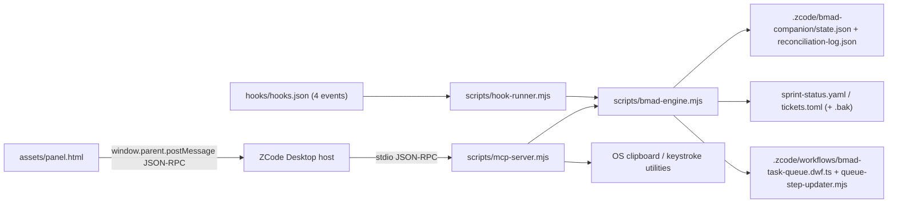
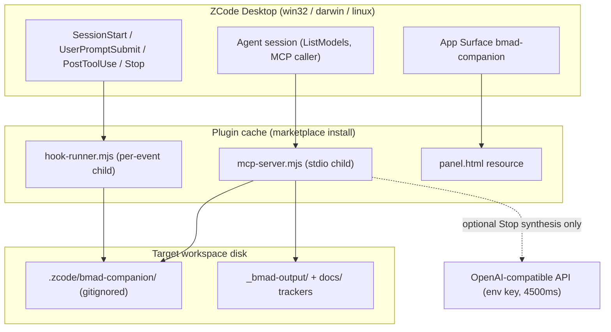
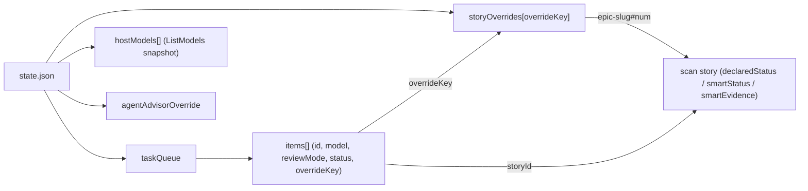

# Architecture Spine — bmad-companion

Initiative-altitude consistency contract for the six hardening epics. Brownfield: the v0.5.2 runtime is shipped; this spine ratifies its invariants, binds the ticket's R1–R23 / C1–C13 (lifting PRD FR-1–FR-22 / RULE-1–RULE-10), and registers PRD-vs-code drift as open questions instead of silently re-deciding it. `AD-n` IDs below are local to this spine; EXPERIENCE.md's accessibility `AD-1–AD-6` and DESIGN.md's `CD-1–CD-5` are separate namespaces, cited with their source prefix.

## Design Paradigm

**Functional core / imperative shell.** One shared-kernel domain core — `scripts/bmad-engine.mjs` — owns every workspace decision: scanning, parsing, dual-progress evidence, model scoring, reconciliation, queue lifecycle, workflow generation. Three thin adapters translate between the core and the outside world; they contain no domain logic of their own:

| Layer | Unit | Role |
| --- | --- | --- |
| Core | `scripts/bmad-engine.mjs` | Deterministic scan/score/reconcile/queue; only module that reads/writes workspace state and trackers |
| Adapter | `scripts/mcp-server.mjs` | JSON-RPC 2.0 stdio transport, 9 tool schemas, OS clipboard/keystroke automation, panel resource serving |
| Adapter | `scripts/hook-runner.mjs` | 4 lifecycle hook modes → core calls → one JSON stdout line |
| Adapter | `assets/panel.html` | Self-contained MCP App UI; reaches the core only through host-relayed `tools/call` |

Read/write split (PRD DEC-4): scans are read-only on trackers; mutation happens only through explicit reconcile and queue actions.

## Invariants & Rules

### AD-1 — Zero-dependency functional core [ADOPTED]

- **Binds:** R10, R17, R18, R23, C1 (RULE-1); all `scripts/*.mjs`, `assets/panel.html`, generated artifacts
- **Prevents:** an epic adding `js-yaml`/`toml`/jsdom or a `package.json`, breaking zero-install runtime and the self-contained panel
- **Rule:** Runtime uses only Node 18+ `node:*` built-ins; YAML/TOML/frontmatter stay hand-rolled (`parseFrontmatter` engine:952, `parseTomlBlocks` engine:979, `parseSprintStatusYaml` engine:1015); tests use `node:test` only; panel stays one inline HTML/CSS/JS file with no CDN.

### AD-2 — Dependency direction: adapters → core, never reverse [ADOPTED]

- **Binds:** all four runtime units, C1
- **Prevents:** circular imports, a second copy of domain logic growing inside an adapter, panel-side business rules that drift from the engine
- **Rule:** `mcp-server.mjs` and `hook-runner.mjs` import only from `bmad-engine.mjs` (mcp-server:6-13, hook-runner:3-8); the engine imports no adapter; the panel reaches engine functionality exclusively via `tools/call` over the host bridge. New capabilities land in the engine first, then get a thin adapter surface.



### AD-3 — Single state gateway with fixed merge semantics [ADOPTED]

- **Binds:** R3, R9, R20, R21, R22, C4 (RULE-4); every writer of `state.json`
- **Prevents:** lost-update writes, two epics inventing different merge rules, silent divergence between hook writes and queue writes
- **Rule:** All plugin-code writes to `.zcode/bmad-companion/state.json` go through `savePersistedState(workspaceRoot, partial)` (engine:1193). Merge contract: shallow top-level spread; `storyOverrides` merged key-level (existing keys survive a partial that omits them); `taskQueue` shallow-merged when provided, else preserved; `updatedAt` ISO-stamped on every write. Passing an empty `storyOverrides` object does **not** clear keys — clearing requires explicit gateway support (see OQ-F). Reads go through `loadPersistedState` (engine:1164), which owns the default shape and any future migration (AD-14).

### AD-4 — Read-only scan, explicit reconcile, backup + dry-run + audit [ADOPTED]

- **Binds:** R5, R10, R11, C8 (RULE-8); PRD FR-5/FR-10/FR-11, DEC-4
- **Prevents:** `bmad_get_state` silently mutating trackers; unrecoverable tracker edits; unaudited reconciliation
- **Rule:** `scanBmadWorkspace` never writes tracker files. Only `reconcileWorkspaceTrackers` (engine:2366) mutates them, line-oriented in place preserving comments/indentation. `dryRun: true` writes zero disk files. `backup !== false` writes `<tracker>.bak` with the pre-edit text before any modification (engine:2470-2473, 2542). Every live run with changes appends an audit entry to `.zcode/bmad-companion/reconciliation-log.json`, newest first, capped at 20 entries (engine:2562-2569).

### AD-5 — Evidence-gated smart status; deterministic primary, optional LLM secondary [ADOPTED]

- **Binds:** R10, R22, C12; PRD FR-10/FR-22, AI behavior §3
- **Prevents:** hallucinated `done` inflation of Smart AI Progress; an epic making scans depend on network calls
- **Rule:** Scanning, evidence evaluation, and scoring run offline and deterministic. `smartStatus = done` only on verified evidence: `storyOverrides[overrideKey].status === "done"`, story plan frontmatter `done`/`completed`/`shipped`, parent epic done with completed retrospective, or implementation report with `failCount === 0` (engine:1368-1383, 1596-1627). Failing reports (`failCount > 0`) hold `review` and emit a remediation story + warning insight (engine:1629-1656). Every upgrade carries a `smartEvidence` string. The only LLM call is `tryOptionalAiTurnSynthesis` on `Stop` (hook-runner:20), gated on `BMAD_COMPANION_OPENAI_KEY`/`OPENAI_API_KEY`, bounded by `AbortSignal.timeout(4500)`, failing silently to `null`.

### AD-6 — Workspace path confinement with normalized paths [ADOPTED]

- **Binds:** R7, R8, R17, C3 (RULE-3); PRD FR-7/FR-8/FR-17
- **Prevents:** `..` traversal reads/opens/writes outside the workspace; Windows backslash paths leaking into contracts
- **Rule:** Every artifact operation normalizes `\` → `/`, resolves against `workspaceRoot`, and rejects anything not equal to the root or prefixed by root + separator (engine:2251-2257, 2333-2339). All `relPath` values in scans and outputs use `/` (engine:1145). Tracker writes target only files discovered inside the workspace walk. `workspaceRoot` resolves from `ZCODE_WORKSPACE_ROOT` / `ZCODE_PROJECT_DIR` / `CLAUDE_PROJECT_DIR` / `process.cwd()` (mcp-server:171-178) or `payload.cwd` first for hooks (hook-runner:71-76).

### AD-7 — Bounded scan envelope [ADOPTED mechanism; numbers per C10]

- **Binds:** R17, C10 (RULE-10), C11; PRD FR-17, SLOs
- **Prevents:** unbounded walks/reads/git calls blowing the ≤250ms scan and ≤300ms tool-call budgets on large repos
- **Rule:** Every scan path is bounded by explicit caps at the call site: `walkFiles` depth limit + extension allowlist (`.md .toml .yaml .yml .csv .json`) + skip dirs (`.git`, `node_modules`, `bin`, `obj`, `plugins`) (engine:1118-1154); `safeReadText` byte cap; `execFileSync` git timeout on every git call. Binding numbers are C10: depth ≤ 4, heuristic reads 24–30KB, git ≤ 2500ms. Current call sites exceed these (walk depth 6/5, reads up to 120KB, git 3000–4000ms) — tracked as OQ-C; hardening epics must close the gap or the PO must relax C10 with evidence. No new unbounded read/walk/git call may land.

### AD-8 — Recommendation and model-routing contract [ADOPTED]

- **Binds:** R3, R6, R18, R19, C2 (RULE-2); PRD FR-3/FR-6/FR-18/FR-19, SM-1
- **Prevents:** bare skill names reaching the user; two epics emitting different recommendation shapes; routing that ignores live provider state
- **Rule:** Every recommendation carries `fullCommand` matching `/^\/bmad-[a-z0-9-]+\s+".+"$/` plus `recommendedModel` with `modelId` in `providerId/modelId` form, `tier`, and `reason` (engine:2073-2090, 894-901). Scoring uses the four capability profiles (`deep-reasoning`, `creative-ux`, `agentic-coding`, `planning-fast` — engine:854-859; PRD calls the third `coding`, OQ-D) over enabled models only; `state.json -> hostModels` pushed from live `ListModels` via `bmad_update_advisor` overrides disk `~/.zcode/v2/provider_config.json` (engine:417, mcp-server:661). With no enabled models, fall back to the host-default recommendation object (engine:861-869). Recommendation count cap: FR-6 says 6, code slices 7 (engine:2247) — OQ-D.

### AD-9 — Panel bridge and CSP compliance [ADOPTED]

- **Binds:** R1, R2, R12, C7 (RULE-7); PRD FR-1/FR-2/FR-12, Non-goal 2
- **Prevents:** a `window.zcode` dependency, eval/CDN introduction breaking the MCP App sandbox, XSS through unescaped artifact content
- **Rule:** The panel talks to the host only via `window.parent.postMessage` JSON-RPC 2.0: `ui/initialize`, `tools/call`, `ui/message`, `ui/update-model-context`, and handled notifications (`ping`, `ui/notifications/host-context-changed`, `ui/notifications/tool-result`) (panel:1103-1168). Zero `eval`, zero external resources; every dynamic string interpolated into HTML passes `escapeHtml()` (panel:1300-1306). The server serves `ui://bmad-companion/panel.html` as `text/html;profile=mcp-app` with CSP `unsafeEval: false` meta (mcp-server:935-953; host key is `zcode/csp`, OQ-G).

### AD-10 — Polling non-interference state machine [ADOPTED]

- **Binds:** R12, R13, R14, C9 (RULE-9); PRD FR-12/FR-13/FR-14, SM-2
- **Prevents:** 5s polls dropping keystrokes, stealing focus, or clobbering user prompt/model edits; two epics re-rendering unconditionally
- **Rule:** One 5000ms interval, gated on `!document.hidden` (panel:2810-2814; FR-12 wording `visibilityState === "visible"` is equivalent here, OQ-H). `refreshState` skips when `isRefreshing`, and background refreshes skip when `isUserInteractingWithForm()` — checked both before and after the awaited tool call; mid-flight results stash into `pendingWorkspaceState` (panel:1357-1377). The guard is true while focus is in `TEXTAREA`/`INPUT` or within `selectOpenUntil` (15000ms after select open/navigation) (panel:1054-1085). `flushPendingState()` runs on `focusout`, select `change`, `Escape`, `Tab` (panel:1062-1101). `ui/notifications/tool-result` obeys the same guard (panel:1157-1167). User edits survive polls via `userEditedPrompts`/`userSelectedModels` keyed against the unchanged server base command/model (panel:1316-1335); every tab container diffs its JSON signature in `lastSectionSignatures` before touching `innerHTML` (panel:1039-1049, 1580-1581).

### AD-11 — Queue ledger ownership and lifecycle [ADOPTED]

- **Binds:** R9, R15, R20, R22, C4; PRD FR-9/FR-15/FR-20/FR-22, SM-5
- **Prevents:** two writers advancing the queue incompatibly; multiple simultaneous running tasks; queue/story status desync
- **Rule:** `state.json -> taskQueue` is the single ledger; `manageBmadTaskQueue` (engine:2956) is the only in-process mutator, exposing exactly the 14 actions of R9. At most one item is `running`: `start-task` demotes any other running item to `queued` (engine:3129-3131); `complete-task` auto-advances the next queued item or settles the queue to `paused`/`completed` (engine:3153-3167). Item status vocabulary: `queued | running | done | failed | skipped`; queue status: `idle | running | paused | completed`. Starting/completing a task with an `overrideKey` writes the matching `storyOverrides` entry in the same `savePersistedState` call (engine:3107-3112, 3140-3145, 3197-3208) — queue and story state never diverge (SM-5). Hooks auto-start/auto-complete only through these same actions (hook-runner:129, 187-192).

### AD-12 — Generated execution artifacts are standalone and semantics-compatible [ADOPTED]

- **Binds:** R15, R16; PRD FR-15/FR-16, DEC-5, SM-5
- **Prevents:** the workflow updater and the engine evolving incompatible queue/story state shapes; review-mode drift between prompt text and generated plan
- **Rule:** `generateQueueWorkflowFiles` (engine:2739) emits `.zcode/workflows/bmad-task-queue.dwf.ts` + `.zcode/bmad-companion/queue-step-updater.mjs`. The updater runs in the workflow sandbox with `cwd = workspace` and cannot import the plugin engine; it must therefore replicate AD-3 semantics for the fields it touches (`taskQueue.items`, `activeTaskId`, `status`, `storyOverrides`, `updatedAt`) and keep the override entry shape `status` + `reason` (+ `updatedAt` where the engine writes it). `effectivePrompt` is produced only by `buildEffectiveTaskPrompt` (engine:2607): `none` → oneshot + deterministic verification suffix, `quick` → oneshot + single self-review, `thorough` → full multi-lens gate; `/bmad-build` upgrades to `/bmad-build-auto` in queue context. `separate-sessions` mode emits the sequential `CreateSession` + `WaitSessions` plan with `start-task`/`complete-task` calls around each session (engine:2938-2944).

### AD-13 — Hook stdout isolation and root resolution [ADOPTED]

- **Binds:** R19, R20, R21, R22, C11; PRD FR-19–FR-22
- **Prevents:** hook debug output corrupting the host's JSON parsing; a hook crashing the turn; workspace root mismatch between hooks and MCP server
- **Rule:** `hook-runner.mjs` writes exactly one JSON line to stdout per invocation — `{ additionalContext }` for `session-start`, `{}` otherwise — and swallows every failure to `{}` (hook-runner:97, 134, 155, 215, 219, 222-224). No console logging to stdout. Mode names are `session-start | user-prompt | post-tool | stop` (hooks/hooks.json wiring). `recentTouchedFiles` keeps ≤ 15 workspace-relative `/` paths confined to the root (hook-runner:148-153); prompt/message captures are length-bounded (4000/6000 chars). Deterministic hooks stay within the ≤350ms p95 budget; only `Stop` with optional LLM synthesis may reach ≤4800ms (C11).

### AD-14 — MCP envelope, additive versioning, version tri-sync [ADOPTED]

- **Binds:** R1–R9, C6 (RULE-6), C13; PRD API contract §1–§3
- **Prevents:** breaking panel/agent clients in a patch release; version drift across manifest, marketplace, and server; tool errors killing the stdio loop
- **Rule:** Line-delimited JSON-RPC 2.0 over stdio; requests without `id` are ignored; tool failures return `isError: true` results while protocol failures use `-32601/-32602/-32603` (mcp-server:835-962). Additive optional inputs/output keys are non-breaking (`0.5.x`); renaming tools, removing `structuredContent.metrics` fields, or changing the `overrideKey` format requires a `0.x.0` bump plus migration in `loadPersistedState`. `version` and descriptions stay synchronized across `.zcode-plugin/plugin.json`, `../marketplace.json`, and `serverInfo.version` (mcp-server:873-876); the panel's `appInfo.version` (panel:1173) and displayed title version (panel:1398) join the sync set. `protocolVersion` is echoed from the client with a server fallback — the three documented values disagree (OQ-A); the echo behavior is the ratified contract.

### AD-15 — OS automation fallback ladder [ADOPTED]

- **Binds:** R4, R8, C11; PRD FR-4/FR-8, SM-4, A-2
- **Prevents:** blocked keystrokes failing the whole launch; prompt text interpolated into a shell; runaway child processes
- **Rule:** Clipboard copy first, synthetic keystrokes second (`^n`/`^v` or `cmd+n`/`cmd+v`), graceful degradation to `copied: true` with an instructional toast when keystrokes fail (mcp-server:66-169, panel:1206-1238). Hard child-process timeouts: 8000ms win32, 6000ms darwin, 2500ms linux (mcp-server:95, 130, 148-162); external artifact opens time out at 3000ms (engine:2345-2353). On win32 the prompt travels as a base64 env var decoded inside PowerShell — never string-interpolated into the script (mcp-server:76, 92). Launch never auto-submits the prompt (SM-4 guardrail).

### AD-16 — One-command deterministic verification harness [ADOPTED from ticket; to build]

- **Binds:** R23, C1, C11; PRD Developer experience, SM-1–SM-5; initiative Done-when 1
- **Prevents:** each epic inventing its own ad-hoc verification; the baseline's "no automated test suite" gap persisting
- **Rule:** A zero-dependency `node:test` suite under `tests/` runs green with one command, `node --test tests/`, on Node 18+. It automates the syntax trio (`node --check` on all three scripts), the stdio smoke (`initialize`, `tools/list`, `resources/read`), and the SM-1–SM-5 checks: recommendation regex + model pairing, polling-guard behavior via a stubbed-document harness (no jsdom), reconcile validity + `.bak` creation + comment preservation, launch fallback ladder, and review-mode fidelity + queue/story sync. Fixtures live in isolated temp workspaces; the suite never mutates the real repository state. This is the recorded verification gate for every epic in this initiative.

## Consistency Conventions

| Concern | Convention |
| --- | --- |
| Naming | Story `overrideKey` = `<epic-slug>#<story-num>` (PRD glossary); epic/initiative dirs kebab-case `epic-*` / `initiative-*`; queue item ids `qtask-<epic>-<story>` or `qtask-<base36 ts>-<rand>` (engine:2990, 3024); all `relPath` use `/` |
| Data & formats | Timestamps ISO 8601 UTC; model ids `providerId/modelId`; statuses: story `done/review/in-progress/backlog`, queue item `queued/running/done/failed/skipped`; recommendation regex per AD-8; tool results always carry `content` (Markdown) + `structuredContent` |
| State & cross-cutting | All state writes via AD-3 gateway; hooks swallow errors to `{}` (AD-13); tool errors as `isError` results (AD-14); panel escapes all dynamic HTML (AD-9); audit ledger capped 20 entries; `recentTouchedFiles` capped 15; runtime files under `.zcode/bmad-companion/` and `*.bak` never committed (AGENTS.md, ../.gitignore) |
| Upstream skills | `.agents/skills/`, `.zcode/skills/`, `skills-lock.json` are upstream-managed, never hand-edited; plugin-owned skills live only in `skills/bmad-companion/` (C5 / RULE-5) |
| Panel UX floor | EXPERIENCE.md Accessibility Floor AD-1–AD-6 (focus rings, ARIA tabs, live toasts, associated labels, reduced motion, contrast) and DESIGN.md CD-1–CD-5 measured-contrast debt bind all panel changes; essential text ≥ 4.5:1 both themes |
| Operational envelope | Plugin distributes via `a2mus-zcode-plugins` marketplace into the ZCode host plugin cache; runs per-workspace on win32/darwin/linux; all state local, no telemetry; only optional egress is the Stop-hook OpenAI-compatible synthesis (AD-5); no CI infra until OQ-2 settles |

## Stack

| Name | Version |
| --- | --- |
| Node.js (ESM, `node:*` only) | ≥ 18 floor; verified v26.12.1 on this machine |
| bmad-companion plugin | 0.5.2 (tri-synced: plugin.json, marketplace.json, serverInfo) |
| MCP stdio transport | JSON-RPC 2.0; protocolVersion echoed from client (OQ-A: PRD 2024-11-05 / server fallback 2025-11-25 / panel 2026-01-26) |
| Test harness (R23) | `node:test` built-in, Node 18+ |
| ZCode Desktop host | host-managed (ui.surfaces + MCP Apps bridge; A-1) |
| OS utilities | system-provided, unpinned: git, powershell.exe, pbcopy/osascript, wl-copy/xclip/xsel/xdotool, cmd/open/xdg-open |
| BMAD tooling (non-runtime) | Python ≥ 3.11 + uv (verified 3.14.10 / 0.13.8); absent `_bmad/` setup in this repo |

## Structural Seed

Plugin package (code owns the detail):

```text
bmad-companion/
  .zcode-plugin/plugin.json   # manifest + ui.surfaces (surface bmad-companion)
  .mcp.json                   # stdio server wiring
  hooks/hooks.json            # 4 lifecycle events -> hook-runner modes
  scripts/
    bmad-engine.mjs           # core: catalogs, parsers, scanner, scorer, reconciler, queue, workflow generator
    mcp-server.mjs            # adapter: 9 tools, JSON-RPC loop, OS automation, panel resource
    hook-runner.mjs           # adapter: 4 hook modes, optional Stop synthesis
  assets/panel.html           # adapter: 5-tab MCP App UI (inline CSS/JS)
  skills/bmad-companion/      # plugin-owned skill (only editable skill dir)
  commands/bmad-companion.md
  tests/                      # R23 node:test suite (to build, epic-verification-harness)
```

Per-workspace runtime artifacts (generated, gitignored):

```text
<workspace>/.zcode/
  bmad-companion/state.json               # AD-3 gateway; storyOverrides, taskQueue, hostModels, advisor override
  bmad-companion/reconciliation-log.json  # audit ledger, <= 20 entries
  bmad-companion/queue-step-updater.mjs   # generated standalone queue updater (AD-12)
  workflows/bmad-task-queue.dwf.ts        # generated dynamic workflow (AD-12)
```

Deployment / operational topology:



Core state entities (names + relationships; shapes live in code):



## Capability → Architecture Map

| Capability / Area | Lives in | Governed by |
| --- | --- | --- |
| R1 (FR-1) open companion | mcp-server:625-637 + plugin.json ui.surfaces | AD-2, AD-9, AD-14 |
| R2 (FR-2) get state | mcp-server:625-637 → scanBmadWorkspace engine:1223 | AD-4, AD-7, AD-14 |
| R3 (FR-3) update advisor | mcp-server:639-674 | AD-3, AD-8 |
| R4 (FR-4) prepare new session | mcp-server:66-169, 676-705 | AD-15, AD-3 |
| R5 (FR-5) reconcile trackers tool | mcp-server:707-728 → engine:2366 | AD-4 |
| R6 (FR-6) recommend next | mcp-server:730-769 → buildRecommendations engine:2059 | AD-8 (cap drift OQ-D) |
| R7 (FR-7) inspect artifact | engine:2250-2330 | AD-6, AD-7 |
| R8 (FR-8) open artifact file | engine:2332-2364 | AD-6, AD-15 |
| R9 (FR-9) queue manage (14 actions) | mcp-server:505-619, 801-830 → engine:2956 | AD-11, AD-3 |
| R10 (FR-10) dual progress + parsers | engine:952-1056, 1223-2022 | AD-1, AD-5 |
| R11 (FR-11) safe reconcile + audit | engine:2366-2601 | AD-4 (cleanup drift OQ-F) |
| R12 (FR-12) 5s visibility polling | panel:2810-2814, 1357-1377 | AD-10 (OQ-H) |
| R13 (FR-13) form guard + flush | panel:1050-1101, 1157-1167 | AD-10 |
| R14 (FR-14) edit preservation + signatures | panel:1036-1049, 1316-1335 | AD-10 |
| R15 (FR-15) review-mode prompts | engine:2607-2637 | AD-12 |
| R16 (FR-16) dual execution generation | engine:2739-2954 | AD-12 |
| R17 (FR-17) confined discovery + diff | engine:1118-1154, 1226-1227, 1698, 2265-2316 | AD-6, AD-7 (OQ-C) |
| R18 (FR-18) 4-tier model scoring | engine:417-902 | AD-8 (OQ-D) |
| R19 (FR-19) SessionStart context | hook-runner:78-99 | AD-13, AD-8 |
| R20 (FR-20) UserPromptSubmit + auto-start | hook-runner:101-136 | AD-13, AD-11 |
| R21 (FR-21) PostToolUse file tracking | hook-runner:138-157 + hooks.json matcher | AD-13, AD-6 (matcher drift OQ-E) |
| R22 (FR-22) Stop synthesis + auto-complete | hook-runner:159-217 | AD-13, AD-5, AD-11 |
| R23 verification suite | tests/ (to build) | AD-16, AD-1 |
| C1 (RULE-1) zero deps | all runtime | AD-1 |
| C2 (RULE-2) prompt format | engine recommendations + advisor | AD-8 |
| C3 (RULE-3) confinement | engine artifact ops + scanner | AD-6 |
| C4 (RULE-4) state gateway | engine:1193 + all callers | AD-3 |
| C5 (RULE-5) skill immutability | skills/bmad-companion/ only | Conventions |
| C6 (RULE-6) version tri-sync | plugin.json / marketplace.json / mcp-server:875 / panel:1173,1398 | AD-14 |
| C7 (RULE-7) CSP | panel + mcp-server resource meta | AD-9 (OQ-G) |
| C8 (RULE-8) backup + dry-run | engine:2366-2547 | AD-4 |
| C9 (RULE-9) polling non-interference | panel guards | AD-10 |
| C10 (RULE-10) bounded scanning | engine walk/read/git call sites | AD-7 (OQ-C) |
| C11 SLO budgets | scan/tool/hook/OS paths | AD-7, AD-13, AD-15 |
| C12 deterministic primary | engine evidence + hook synthesis | AD-5 |
| C13 API contract + versioning | mcp-server envelope | AD-14 (OQ-A, OQ-B) |

## Open Questions (PRD-vs-code drift register)

Surfaced, not silently resolved. Each needs the named owner before the dependent epic closes; none blocks starting epic-verification-harness (the harness should encode the ratified code behavior and flag these).

| ID | Drift | Evidence | Owner / resolution direction |
| --- | --- | --- | --- |
| OQ-A | protocolVersion: PRD 2024-11-05 vs server fallback 2025-11-25 vs panel 2026-01-26 | prd:254; mcp-server:868; panel:1025 | PO + epic-mcp-surface: ratify echo behavior, fix PRD value |
| OQ-B | structuredContent shapes differ from PRD API table for recommend_next / reconcile / queue_manage / inspect; `lastLaunchedSession` vs `preparedSession` | mcp-server:764-767, 821-828, 686; engine:2580-2600, 2318-2329 vs prd:259-269 | PO: align PRD to shipped shapes (DEC-1 intent) or additive aliases per C13 |
| OQ-C | RULE-10 numbers: walk depth 6/5 vs 4; reads 40–120KB vs 24–30KB; git 3000–4000ms vs 2500ms | engine:1226-1227, 2392, 2481, 374, 2262, 1592, 1078, 1085, 1103, 2271 | Architect + epic owners: harden code to C10 or PO relaxes C10 with SLO evidence |
| OQ-D | rec cap 7 vs FR-6 "up to 6"; profile key `agentic-coding` vs PRD `coding` | engine:2247, 849, 857 vs prd:138, 92 | epic-hooks-model-router + PO |
| OQ-E | PostToolUse matcher `Edit\|Write\|Bash` vs FR-21 Write/Edit/MultiEdit | hooks/hooks.json vs prd:173 | epic-hooks-model-router |
| OQ-F | reconcile passes empty storyOverrides to clear them, but gateway merge preserves keys — cleanup is a no-op; stale overrides can mask later drift | engine:2572-2575 vs engine:1198-1201 | epic-dual-progress-reconciliation: add explicit clear/replace semantics to gateway |
| OQ-G | resource CSP meta key `zcode/csp` vs PRD `_meta.ui.csp` | mcp-server:920, 946 vs prd:255 | PO: ratify host key, fix PRD |
| OQ-H | visibility gate `!document.hidden` vs FR-12 `visibilityState === "visible"` | panel:2811 vs prd:154 | epic-panel-polling-safety: equivalent; encode in R23 guard tests |

## Deferred

- **Per-story implementation detail** — epic altitudes own it; this spine fixes only cross-epic invariants.
- **OQ-1 branch-scoped state.json** (v0.6.0) — partitioning `storyOverrides`/`taskQueue` by git branch; AD-3 gateway is the single place it will land.
- **OQ-2 headless CI `--verify-trackers`** (v0.6.0) — no CI infrastructure exists yet; AD-16 suite is the local gate until then.
- **OQ-3 workspace routing.json model policy** (v1.0.0) — AD-8 scoring chain is the extension point.
- **AST architecture drift checker** (v1.0) and **cross-plugin event bus with Vibe Debrief** (v1.0) — post-MVP per ticket Boundaries.
- **Non-ZCode webview ports** (VS Code/JetBrains) — out of scope for v0.5.x.
- **Visual token values and component styling** — DESIGN.md owns them; this spine only binds the accessibility floor via Conventions.
- **Model roster data** (which model ids rank in which tier) — catalog/scorer data, not architecture; evolves with provider releases under AD-8's contract.
