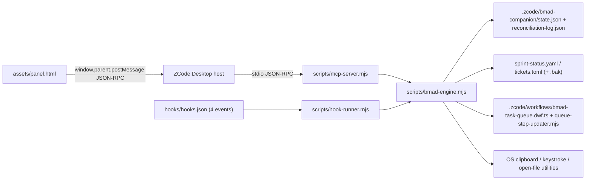
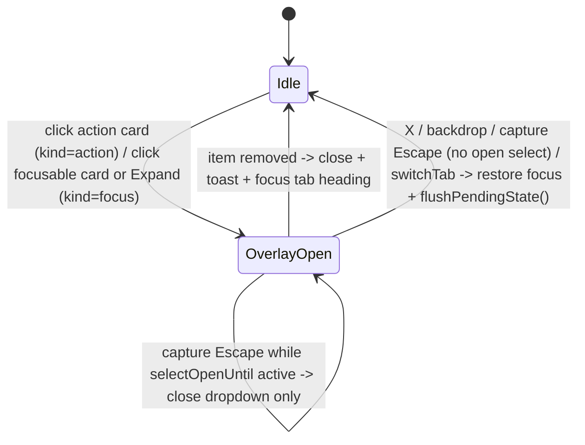
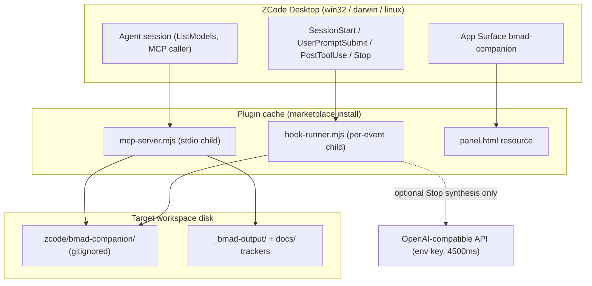
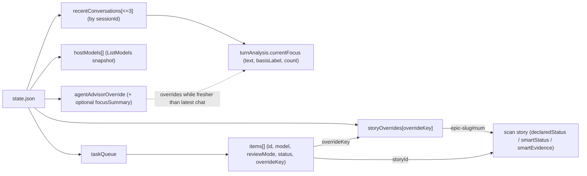

# Architecture Spine — bmad-companion

Initiative-altitude consistency contract covering the shipped v0.5.4 hardening baseline and the 2026-11-25 UX readability update (`RD-7`, `RD-9`, `OQ-6`). Brownfield: the v0.5.4 runtime is shipped; this spine ratifies its invariants, binds the ticket's R1–R23 / C1–C13 (lifting PRD FR-1–FR-22 / RULE-1–RULE-10) plus UX `RD-7`/`RD-9`/`OQ-6`, and registers PRD-vs-code drift as open questions instead of silently re-deciding it. `AD-n` IDs below are local to this spine; EXPERIENCE.md's accessibility `AD-1–AD-6` and DESIGN.md's `CD-1–CD-5` are separate namespaces, cited with their source prefix.

## Design Paradigm

**Functional core / imperative shell.** One shared-kernel domain core — `scripts/bmad-engine.mjs` — owns every workspace decision: scanning, parsing, dual-progress evidence, model scoring, reconciliation, queue lifecycle, workflow generation. Three thin adapters translate between the core and the outside world; they contain no domain logic of their own:

| Layer | Unit | Role |
| --- | --- | --- |
| Core | `scripts/bmad-engine.mjs` | Deterministic scan/score/reconcile/queue/focus-hero + OS clipboard/keystroke/open-file helpers; only module that reads/writes workspace state and trackers |
| Adapter | `scripts/mcp-server.mjs` | JSON-RPC 2.0 stdio transport, 9 tool schemas, panel resource serving |
| Adapter | `scripts/hook-runner.mjs` | 4 lifecycle hook modes → core calls → one JSON stdout line (+ optional Stop LLM synthesis) |
| Adapter | `assets/panel.html` | Self-contained MCP App UI; reaches the core only through host-relayed `tools/call` |

Read/write split (PRD DEC-4): scans are read-only on trackers; mutation happens only through explicit reconcile and queue actions.

## Invariants & Rules

### AD-1 — Zero-dependency functional core [ADOPTED]

- **Binds:** R10, R17, R18, R23, C1 (RULE-1); all `scripts/*.mjs`, `assets/panel.html`, generated artifacts
- **Prevents:** an epic adding `js-yaml`/`toml`/jsdom or a `package.json`, breaking zero-install runtime and the self-contained panel
- **Rule:** Runtime uses only Node 18+ `node:*` built-ins; YAML/TOML/frontmatter stay hand-rolled (`parseFrontmatter`, `parseTomlBlocks`, `parseSprintStatusYaml` in `scripts/bmad-engine.mjs`); tests use `node:test` only; panel stays one inline HTML/CSS/JS file with no CDN.

### AD-2 — Dependency direction: adapters → core, never reverse [ADOPTED]

- **Binds:** all four runtime units, C1
- **Prevents:** circular imports, a second copy of domain logic growing inside an adapter, panel-side business rules that drift from the engine
- **Rule:** `mcp-server.mjs` and `hook-runner.mjs` import only from `bmad-engine.mjs`; the engine imports no adapter; the panel reaches engine functionality exclusively via `tools/call` over the host bridge. New capabilities (including plain-language Work text and focus-hero synthesis) land in the engine first, then get a thin adapter surface.



### AD-3 — Single state gateway with fixed merge semantics [ADOPTED]

- **Binds:** R3, R9, R20, R21, R22, C4 (RULE-4), RD-9; every writer of `state.json`
- **Prevents:** lost-update writes, two epics inventing different merge rules, silent divergence between hook writes and queue writes, partial updates truncating or blanking `recentConversations`
- **Rule:** All plugin-code writes to `.zcode/bmad-companion/state.json` go through `savePersistedState(workspaceRoot, partial)` (`scripts/bmad-engine.mjs:1427`). Merge contract: shallow top-level spread; `storyOverrides` merged key-level (existing keys survive a partial that omits them); `taskQueue` shallow-merged when provided, else preserved; `updatedAt` ISO-stamped on every write (atomic tmp-file + rename). Target RD-9 extension: `savePersistedState` owns a field-preserving upsert/dedup/cap merge for `recentConversations` (keyed by `sessionId`, preserving existing non-empty snippets when a partial hook update omits them, moving the updated session to index 0, capping at 3 entries, and preserving the array untouched when omitted). Passing an empty `storyOverrides` object does **not** clear keys — clearing requires explicit gateway support (see OQ-F). Reads go through `loadPersistedState` (`scripts/bmad-engine.mjs:1406`), which owns the default shape and any future migration (AD-14).

### AD-4 — Read-only scan, explicit reconcile, backup + dry-run + audit [ADOPTED]

- **Binds:** R5, R10, R11, C8 (RULE-8); PRD FR-5/FR-10/FR-11, DEC-4
- **Prevents:** `bmad_get_state` silently mutating trackers; unrecoverable tracker edits; unaudited reconciliation
- **Rule:** `scanBmadWorkspace` never writes tracker files. Only `reconcileWorkspaceTrackers` (engine:2366) mutates them, line-oriented in place preserving comments/indentation. `dryRun: true` writes zero disk files. `backup !== false` writes `<tracker>.bak` with the pre-edit text before any modification (engine:2470-2473, 2542). Every live run with changes appends an audit entry to `.zcode/bmad-companion/reconciliation-log.json`, newest first, capped at 20 entries (engine:2562-2569).

### AD-5 — Evidence-gated smart status; deterministic primary, optional LLM secondary [ADOPTED]

- **Binds:** R10, R22, C12; PRD FR-10/FR-22, AI behavior §3
- **Prevents:** hallucinated `done` inflation of Smart AI Progress; an epic making scans depend on network calls
- **Rule:** Scanning, evidence evaluation, and scoring run offline and deterministic. `smartStatus = done` only on verified evidence: `storyOverrides[overrideKey].status === "done"`, story plan frontmatter `done`/`completed`/`shipped`, parent epic done with completed retrospective, or implementation report with `failCount === 0` (engine:1368-1383, 1596-1627). Failing reports (`failCount > 0`) hold `review` and emit a remediation story + warning insight (engine:1629-1656). Every upgrade carries a `smartEvidence` string. The only LLM call is `tryOptionalAiTurnSynthesis` on `Stop` (hook-runner:20), gated on `BMAD_COMPANION_OPENAI_KEY`/`OPENAI_API_KEY`, bounded by `AbortSignal.timeout(4500)`, failing silently to `null`.

### AD-6 — Workspace path confinement with normalized paths [ADOPTED]

- **Binds:** R7, R8, R17, C3 (RULE-3); PRD FR-7/FR-8/FR-17
- **Prevents:** `..` traversal reads/opens/writes outside the workspace; Windows backslash paths leaking into contracts
- **Rule:** Every artifact operation normalizes `\` → `/`, resolves against `workspaceRoot`, and rejects anything not equal to the root or prefixed by root + separator (engine:2251-2257, 2333-2339). All `relPath` values in scans and outputs use `/` (engine:1145). Tracker writes target only files discovered inside the workspace walk. `workspaceRoot` resolves from `ZCODE_WORKSPACE_ROOT` / `ZCODE_PROJECT_DIR` / `CLAUDE_PROJECT_DIR` / `process.cwd()` (mcp-server:171-178) or `payload.cwd` first for hooks (hook-runner:71-76).

### AD-7 — Bounded scan envelope [ADOPTED]

- **Binds:** R17, C10 (RULE-10), C11; PRD FR-17, SLOs
- **Prevents:** unbounded walks/reads/git calls blowing the ≤250ms scan and ≤300ms tool-call budgets on large repos
- **Rule:** Every scan path is bounded by `SCAN_LIMITS` in `scripts/bmad-engine.mjs`: `walkFiles` depth ≤ 4 + extension allowlist (`.md .toml .yaml .yml .csv .json`) + skip dirs (`.git`, `node_modules`, `bin`, `obj`, `plugins`); `safeReadText` heuristic cap ≤ 30KB; git subprocess timeout ≤ 2500ms via the single git helper. One legacy reconcile walk call site (`reconcileWorkspaceTrackers` depth 6) remains tracked in OQ-C; no new unbounded read/walk/git call may land.

### AD-8 — Recommendation, plain-language Work text, and model-routing contract [ADOPTED; extended 2026-11-25]

- **Binds:** R3, R6, R18, R19, C2 (RULE-2), RD-9; PRD FR-3/FR-6/FR-18/FR-19, SM-1
- **Prevents:** bare skill names reaching the user; two epics emitting different recommendation shapes; routing that ignores live provider state; UI-side text rewriting violating AD-2 when hiding BMAD jargon on the Work tab
- **Rule:** Every recommendation carries `fullCommand` matching `/^\/bmad-[a-z0-9-]+\s+".+"$/` plus `recommendedModel` with `modelId` in `providerId/modelId` form, `tier`, and `reason`. Target RD-9 additive extension: `bmad-engine.mjs` also emits jargon-free `plainTitle` and `plainSummary` fields on every recommendation so the Work tab's compact cards speak plain human language without forcing `assets/panel.html` to rewrite domain copy (existing `title`, `rationale`, `skill`, `phase` remain untouched for AD-14 compatibility and the Action Window's "Technical details" line). Scoring uses the four capability profiles (`deep-reasoning`, `creative-ux`, `agentic-coding`, `planning-fast`) over enabled models only; `state.json -> hostModels` pushed from live `ListModels` via `bmad_update_advisor` overlays/merges with disk `~/.zcode/v2/provider_config.json` (partial lists merge via `mergeHostModelCatalogs` so accessible models are never hidden). With no enabled models, fall back to the host-default recommendation object. Recommendation count is capped at 6 in `buildRecommendations`.

### AD-9 — Panel bridge, display-mode boundary, and CSP compliance [ADOPTED]

- **Binds:** R1, R2, R12, C7 (RULE-7), OQ-6, RD-7, RD-9; PRD FR-1/FR-2/FR-12, Non-goal 2
- **Prevents:** a `window.zcode` dependency, eval/CDN introduction breaking the MCP App sandbox, XSS through unescaped artifact content, or broken `ui/request-display-mode` calls expecting a host popup that does not exist
- **Rule:** The panel talks to the host only via `window.parent.postMessage` JSON-RPC 2.0: `ui/initialize` (declaring `availableDisplayModes: ["inline", "fullscreen"]`), `tools/call`, `ui/message`, `ui/update-model-context`, and handled notifications (`ping`, `ui/notifications/host-context-changed`, `ui/notifications/tool-result`) (`assets/panel.html:1319-1398`). Zero `eval`, zero external resources; every dynamic string interpolated into HTML passes `escapeHtml()` (`assets/panel.html:1522-1529`). The server serves `ui://bmad-companion/panel.html` as `text/html;profile=mcp-app` with CSP `unsafeEval: false` meta (`scripts/mcp-server.mjs:730-750`; host key `zcode/csp`). **OQ-6 closed (verified against ZCode Desktop host 2026-11-25):** right-side MCP App surfaces already run in `displayMode: "fullscreen"` (`availableDisplayModes: ["inline", "fullscreen"]` or `["fullscreen"]`); requesting `"fullscreen"` via `ui/request-display-mode` is a no-op and requesting `"inline"` closes the side pane. No host-managed wider modal mode exists; therefore Focus View (RD-7) and the Work Action Window (RD-9) MUST render as in-iframe overlays inside `assets/panel.html` (AD-17), adapting fluidly to host pane width.

### AD-10 — Polling non-interference state machine & draft preservation [ADOPTED; extended 2026-11-25]

- **Binds:** R12, R13, R14, C9 (RULE-9), RD-7, RD-9; PRD FR-12/FR-13/FR-14, SM-2
- **Prevents:** 5s polls dropping keystrokes, stealing focus, replacing an open Focus View/Action Window, or clobbering user prompt/model edits; capture-vs-bubble Escape races; stale stashed state rolling back explicit overlay mutations
- **Rule:** One 5000ms interval, gated on `isPanelVisible()` (`!document.hidden && document.visibilityState === "visible"`, `assets/panel.html:3326-3330`). `refreshState` skips when `isRefreshing`, and background refreshes skip when `isUserInteractingWithForm()` — checked both before and after the awaited tool call; mid-flight results stash into `pendingWorkspaceState` (`assets/panel.html:1656-1676`). The guard predicate is true whenever any of three clauses holds: (a) `Date.now() < selectOpenUntil` (15000ms after select open/navigation), (b) `document.activeElement` is `TEXTAREA` or `INPUT`, or (c) **target RD-7/RD-9: an overlay is open (`isOverlayOpen()`, AD-17)**. `flushPendingState()` runs on `focusout` (50ms), select `change` (0ms), `Escape`, `Tab`, and (target RD-7/RD-9) overlay close (0ms). `ui/notifications/tool-result` obeys the same guard (`assets/panel.html:1373-1383`). **Explicit user actions triggered from inside an open overlay** MUST clear `pendingWorkspaceState = null` before calling `renderWorkspaceState(freshState)` (preventing an older stashed payload from rolling the UI backward on close): same-tab actions (e.g., queue model/review change, Mark Done, Retry, Remove) update the underlying tab and call `reconcileActiveOverlay(freshState)` in place — or close cleanly with toast `"That item is no longer available"` and tab-heading focus fallback if the targeted item was removed; tab-jumping actions (e.g., `"Add to Queue"` from the Work Action Window, which calls `switchTab("queue")` per `EXPERIENCE.md`) close the overlay via `switchTab()` per AD-17. **Single capture-phase Escape ownership (target RD-7/RD-9):** the existing capture-phase `keydown` listener (`assets/panel.html:1280`) owns Escape precedence in one place: (1) if `Date.now() < selectOpenUntil`, clear `selectOpenUntil = 0`, stop propagation, and keep the overlay open; (2) else if `isOverlayOpen()`, call `closeOverlay()` immediately (even when focused inside a `TEXTAREA`/`INPUT`), restoring focus and flushing stashed state; (3) else run non-overlay Escape behavior. **Draft preservation & signatures:** `userEditedPrompts`/`userSelectedModels` Maps keyed by canonical semantic key (`rec:<skill>:<title>`, never falling back to DOM index; batch selection moves from `selectedRecIndices` to `selectedRecKeys` `Set<recKey>`) are the single source of truth across Work cards, the Action Window, batch queue selection, and Focus View. One shared `getRecommendationBaseModelId(rec)` helper supplies the base model ID identically across card render, Action Window, and batch enqueue so `resolveUserModel` never drops drafts on a base mismatch; batch enqueue and action handlers read via `resolveUserPrompt`/`resolveUserModel`, never by DOM lookup of unmounted cards. Every tab container diffs its JSON signature in `lastSectionSignatures` before touching `innerHTML`, and `recommendations` includes draft Map overrides so compact Work cards reflect saved drafts.

### AD-11 — Queue ledger ownership and lifecycle [ADOPTED]

- **Binds:** R9, R15, R20, R22, C4; PRD FR-9/FR-15/FR-20/FR-22, SM-5
- **Prevents:** two writers advancing the queue incompatibly; multiple simultaneous running tasks; queue/story status desync
- **Rule:** `state.json -> taskQueue` is the single ledger; `manageBmadTaskQueue` (`scripts/bmad-engine.mjs`) is the only in-process mutator, exposing all **15** queue actions (`get`, `add`, `add-batch`, `add-epic`, `update-item`, `reorder`, `remove`, `clear`, `set-review-mode`, `set-execution-mode`, `start-queue`, `pause-queue`, `start-task`, `complete-task`, `retry-failed`). At most one item is `running`: `start-task` demotes any other running item to `queued`, records the launching `sessionId`, and is the only action that promotes an item to `running`; `complete-task` leaves the next item `queued`, clears `activeTaskId`, and settles the queue to `running` (more work remains), `paused` (failure or pause), or `completed`; `retry-failed` resets one or all failed items to `queued` and clears failure metadata. Item status vocabulary: `queued | running | done | failed | skipped`; queue status: `idle | running | paused | completed`. Starting/completing a task with an `overrideKey` writes the matching `storyOverrides` entry in the same `savePersistedState` call — queue and story state never diverge (SM-5). Hooks auto-start/auto-complete only through these same actions, and the `Stop` hook hands off to the next task via a continuation directive (`scripts/hook-runner.mjs`).

### AD-12 — Generated execution artifacts are standalone and semantics-compatible [ADOPTED]

- **Binds:** R15, R16; PRD FR-15/FR-16, DEC-5, SM-5
- **Prevents:** the workflow updater and the engine evolving incompatible queue/story state shapes; review-mode drift between prompt text and generated plan
- **Rule:** `generateQueueWorkflowFiles` (engine:2739) emits `.zcode/workflows/bmad-task-queue.dwf.ts` + `.zcode/bmad-companion/queue-step-updater.mjs`. The updater runs in the workflow sandbox with `cwd = workspace` and cannot import the plugin engine; it must therefore replicate AD-3 semantics for the fields it touches (`taskQueue.items`, `activeTaskId`, `status`, `storyOverrides`, `updatedAt`) and keep the override entry shape `status` + `reason` (+ `updatedAt` where the engine writes it). `effectivePrompt` is produced only by `buildEffectiveTaskPrompt` (engine:2607): `none` → oneshot + deterministic verification suffix, `quick` → oneshot + single self-review, `thorough` → full multi-lens gate; `/bmad-build` upgrades to `/bmad-build-auto` in queue context. `separate-sessions` mode emits a `CreateSession` handoff plan: the launcher starts only the first task, records its `sessionId` via `start-task`, and ends its turn; each finished task session's `Stop` hook continues with the next task (engine:2955-2985, hook-runner:159-215).

### AD-13 — Hook stdout isolation and root resolution [ADOPTED]

- **Binds:** R19, R20, R21, R22, C11; PRD FR-19–FR-22
- **Prevents:** hook debug output corrupting the host's JSON parsing; a hook crashing the turn; workspace root mismatch between hooks and MCP server
- **Rule:** `hook-runner.mjs` writes exactly one JSON line to stdout per invocation — `{ additionalContext }` for `session-start`, `{}` otherwise, or `{ decision: "block", reason }` when a finished queue task hands off to the next task — and swallows every failure to `{}` (hook-runner:97, 134, 155, 215, 219, 226-245). No console logging to stdout. Mode names are `session-start | user-prompt | post-tool | stop` (hooks/hooks.json wiring). The `Stop` completion path only acts when the task's recorded `sessionId` matches `CLAUDE_SESSION_ID` (or either is absent for legacy state), so sibling sessions cannot complete each other's tasks. `recentTouchedFiles` keeps ≤ 15 workspace-relative `/` paths confined to the root (hook-runner:150-155); prompt/message captures are length-bounded (4000/6000 chars). Deterministic hooks stay within the ≤350ms p95 budget; only `Stop` with optional LLM synthesis may reach ≤4800ms (C11).

### AD-14 — MCP envelope, additive versioning, version tri-sync [ADOPTED]

- **Binds:** R1–R9, C6 (RULE-6), C13, RD-9; PRD API contract §1–§3
- **Prevents:** breaking panel/agent clients in a patch release; version drift across manifest, marketplace, and server; tool errors killing the stdio loop; UI tab consolidation accidentally deleting backend fields; strict tool schemas rejecting new additive advisor fields
- **Rule:** Line-delimited JSON-RPC 2.0 over stdio; requests without `id` are ignored; tool failures return `isError: true` results while protocol failures use `-32601/-32602/-32603` (`scripts/mcp-server.mjs:661-755`). Additive optional inputs/output keys are non-breaking (`0.5.x`); renaming tools, removing `structuredContent.metrics` or top-level scan keys, or changing the `overrideKey` format requires a `0.x.0` bump plus migration in `loadPersistedState`. Specifically: (1) removing the Skills and Specialist Agents UI lists under RD-9 MUST NOT remove `skillsCatalog` or `agentsCatalog` from `bmad_get_state` `structuredContent`; (2) `bmad_update_advisor` (which uses `additionalProperties: false`) MUST add optional additive schema fields `focusSummary` (string) and `sessionId` (string) when AD-18 lands. `version` and descriptions stay synchronized across `.zcode-plugin/plugin.json`, `../marketplace.json`, and `serverInfo.version` (`scripts/mcp-server.mjs:699-702`, enforced by `scripts/check-version-sync.mjs`); `assets/panel.html`'s `appInfo.version` (`assets/panel.html:1389`) and displayed title version stay in sync as part of the release checklist. `protocolVersion` is echoed from the client with a server fallback (`2025-11-25`).

### AD-15 — OS automation fallback ladder [ADOPTED]

- **Binds:** R4, R8, C11; PRD FR-4/FR-8, SM-4, A-2
- **Prevents:** blocked keystrokes failing the whole launch; prompt text interpolated into a shell; runaway child processes
- **Rule:** Owned by `scripts/bmad-engine.mjs` (`prepareNewSession` / `openNewConversationWithPrompt` / `openWorkspaceArtifactExternally`), delegated thinly from `scripts/mcp-server.mjs`. Clipboard copy first, synthetic keystrokes second (`^n`/`^v` or `cmd+n`/`cmd+v`), graceful degradation to `copied: true` with an instructional toast when keystrokes fail (`assets/panel.html:1422-1460`). Hard child-process timeouts: 8000ms win32, 6000ms darwin, 2500ms linux; external artifact opens time out at 3000ms. On win32 the prompt travels as a base64 env var decoded inside PowerShell — never string-interpolated into the script. Launch never auto-submits the prompt (SM-4 guardrail).

### AD-16 — One-command deterministic verification harness [ADOPTED]

- **Binds:** R23, C1, C11, RD-7, RD-9; PRD Developer experience, SM-1–SM-5; initiative Done-when 1
- **Prevents:** each epic inventing its own ad-hoc verification; the baseline's "no automated test suite" gap persisting; RD-7/RD-9 regressions against the stubbed-DOM harness
- **Rule:** A zero-dependency `node:test` suite under `tests/` runs green with one command, `node --test "tests/*.test.mjs" && node scripts/check-version-sync.mjs`, on Node 18+ (glob quoted for Node 22 compatibility). It automates the syntax trio (`node --check` on all three scripts), the stdio smoke (`initialize`, `tools/list`, `resources/read`), panel accessibility checks, and the SM-1–SM-5 checks: recommendation regex + model pairing, polling-guard + overlay-guard + draft-preservation behavior via a stubbed-document harness (`tests/panel-guards.test.mjs`, extending `window.__bmadTestHooks` for overlay open/close/Escape/reconcile and 3-tab semantics without jsdom), reconcile validity + `.bak` creation + comment preservation, launch fallback ladder, and review-mode fidelity + queue/story sync. Fixtures live in isolated temp workspaces; the suite never mutates the real repository state. This is the recorded verification gate for every epic in this initiative.

### AD-17 — Unified in-iframe overlay controller, 3-tab IDs & non-duplicating DOM contract [ADOPTED 2026-11-25]

- **Binds:** OQ-6, RD-7 (Focus View), RD-8 (disclosures), RD-9 (3-tab Work/Queue/Project + Work Action Window), AD-9, AD-10; `assets/panel.html`
- **Prevents:** two stories building separate Focus View and Action Window dialogs with colliding focus traps, double backdrops, split polling-guard flags, cloned background DOM element IDs (`#rec-cmd-*`, `#q-model-*`) breaking `getElementById`, detached `triggerEl` focus loss, or interactive child buttons accidentally opening Focus View
- **Rule:**
  1. **3-tab IDs & in-memory UI state (RD-8/RD-9):** Ratified tab IDs are `work`, `queue`, `project` (`switchTab` resets scroll and closes any open overlay; Phase artifact chips inspect diffs inline inside `project` rather than calling `switchTab("artifacts")`). Collapsed-by-default RD-8 disclosures (`ai-notes`, `models-providers`, `more-actions`) persist open/closed state in one in-memory `expandedDisclosures` Set across poll renders.
  2. **Single overlay controller:** One shared in-iframe controller owns `activeOverlay` (`null | { kind: "action" | "focus", targetType, targetKey, triggerEl, triggerSelector }`). At most one overlay is open at a time (no stacked overlays; the Work Action Window opens at comfortable reading size so no nested Focus View is needed); switching tabs closes any open overlay. The overlay mounts into one dedicated `<div role="dialog" aria-modal="true" aria-labelledby="overlayTitle">` layer inside `assets/panel.html`, locking main scroll, moving focus inside on open, trapping `Tab`, and restoring focus on close to `triggerEl` (if `isConnected`), else `document.querySelector(triggerSelector)`, else the active tab heading.
  3. **Non-duplicating DOM & click guard:** Overlays render directly from `currentState` + shared draft Maps (`userEditedPrompts`/`userSelectedModels`) using overlay-namespaced DOM IDs (`overlay-*`) and **never** clone or duplicate live background element IDs. Focusable card/row click listeners MUST ignore events originating inside interactive descendants (`button, a, input, select, textarea, label, [role="tab"], .status-pill`) so buttons, tabs, and status labels keep their normal click (RD-7).
  4. **Canonical `targetType` / `targetKey` map:** `action` uses `recommendation` → `rec:<skill>:<title>`; `focus` uses `queue-item` → `item.id`, `active-spotlight` → `taskQueue.activeTask.id`, `epic` → `epic.id`, `story` → `story.overrideKey || story.id`, `phase` → `phase.id`, `artifact` → `artifact.relPath`, `reconciliation-diff` → `"reconciliation-diff"`, `insights` → `"insights"`.



### AD-18 — Rolling 3-conversation memory & jargon-free focus hero [ADOPTED 2026-11-25]

- **Binds:** RD-9 (Work current-focus hero), AD-3, AD-5, AD-6, AD-13, AD-14; `scripts/bmad-engine.mjs`, `scripts/hook-runner.mjs`, `scripts/mcp-server.mjs`, `assets/panel.html`
- **Prevents:** single-turn overwrite losing prior chat context; reading ZCode host-private session stores outside workspace confinement; BMAD jargon leaking into the Work hero; same-turn `Stop` hook self-expiring a fresh AI `focusSummary`; duplicate fallback entries inflating `conversationCount`
- **Rule:**
  1. **Rolling 3-chat buffer (AD-3):** `.zcode/bmad-companion/state.json` adds an additive `recentConversations` array (capped at 3 entries, newest first), merged exclusively through `savePersistedState` (field-preserving upsert by `sessionId`). Only `hook-runner.mjs` (`UserPromptSubmit` / `Stop`, staying inside AD-13's ≤350ms deterministic budget) writes conversation entries; `bmad_update_advisor` does **not** create fallback dated entries when `sessionId` is omitted, preventing one chat from occupying two slots. Each entry stores bounded workspace-confined fields: `sessionId`, `updatedAt`, `completedAt` (stamped on `Stop`), `promptSnippet` (≤300 chars), `outcomeSnippet` (≤400 chars), `touchedCount`.
  2. **Deterministic jargon-free synthesis & closed schema (AD-5):** `bmad-engine.mjs` computes `turnAnalysis.currentFocus = { text, basisLabel, conversationCount, source }` where `source` is the closed enum `"advisor-override" | "stop-synthesis" | "deterministic"`. `text` is 1–2 plain everyday sentences; the engine enforces a jargon filter rejecting/stripping BMAD tokens (`/bmad-*`, phase codes, tracker filenames) on **both** deterministic text and AI `focusSummary` overrides (falling back to deterministic text if an override fails validation). The Work hero MUST render `turnAnalysis.currentFocus` and never fall back to `turnAnalysis.aiSummaryHeadline`.
  3. **Same-turn-safe freshness, label & honest count:** An AI `focusSummary` override (carrying `updatedAt` and optional `sessionId` via `bmad_update_advisor` or `Stop` synthesis) expires as stale when a **subsequent** conversation finishes (`completedAt > override.updatedAt` with a different `sessionId`, or after a newer prompt started at `lastUserPromptAt > override.updatedAt`) — preventing `Stop` firing seconds after `bmad_update_advisor` in the same turn from killing the summary just written — in addition to existing workflow/queue completion staleness checks. `basisLabel` emits `"Current focus"` (per the owner's label decision in `EXPERIENCE.md`, replacing `"Based on your last … conversations"`), while `conversationCount` always reflects the true recorded count (`0..3` from `recentConversations.length`).

## Consistency Conventions

| Concern | Convention |
| --- | --- |
| Naming | Story `overrideKey` = `<epic-slug>#<story-num>` (PRD glossary); epic/initiative dirs kebab-case `epic-*` / `initiative-*`; queue item ids `qtask-<epic>-<story>` or `qtask-<base36 ts>-<rand>` (engine:2990, 3024); all `relPath` use `/` |
| Data & formats | Timestamps ISO 8601 UTC; model ids `providerId/modelId`; statuses: story `done/review/in-progress/backlog`, queue item `queued/running/done/failed/skipped`; recommendation regex per AD-8; tool results always carry `content` (Markdown) + `structuredContent` |
| State & cross-cutting | All state writes via AD-3 gateway; hooks swallow errors to `{}` (AD-13); tool errors as `isError` results (AD-14); panel escapes all dynamic HTML (AD-9); audit ledger capped 20 entries; `recentTouchedFiles` capped 15; `recentConversations` capped 3 (AD-18); one active in-iframe overlay with `overlay-*` DOM IDs (AD-17); runtime files under `.zcode/bmad-companion/` and `*.bak` never committed (AGENTS.md, ../.gitignore) |
| Upstream skills | `.agents/skills/`, `.zcode/skills/`, `skills-lock.json` are upstream-managed, never hand-edited; plugin-owned skills live only in `skills/bmad-companion/` (C5 / RULE-5) |
| Panel UX floor | EXPERIENCE.md Accessibility Floor AD-1–AD-6 (focus rings, ARIA tabs, live toasts, associated labels, reduced motion, contrast), RD-7/RD-9 dialog semantics, and DESIGN.md Palette C / CD-1–CD-5 contrast floor bind all panel changes; essential text ≥ 4.5:1 both themes |
| Operational envelope | Plugin distributes via `a2mus-zcode-plugins` marketplace into the ZCode host plugin cache; repo-root CI (`../.github/workflows/validate.yml`) runs validation, `node --test "tests/*.test.mjs"`, and version-sync checks on Node 22; runs per-workspace on win32/darwin/linux; all state local, no telemetry; only optional egress is the Stop-hook OpenAI-compatible synthesis (AD-5) |

## Stack

| Name | Version |
| --- | --- |
| Node.js (ESM, `node:*` only) | ≥ 18 floor (CI runs Node 22); verified v26.12.1 on this machine |
| bmad-companion plugin | 0.5.4 (tri-synced: plugin.json, marketplace.json, serverInfo, panel appInfo/title) |
| MCP stdio transport | JSON-RPC 2.0; protocolVersion echoed from client (OQ-A: PRD 2024-11-05 / server fallback 2025-11-25 / panel 2026-01-26) |
| Test harness (R23) | `node:test` built-in, Node 18+ (`node --test "tests/*.test.mjs"`) |
| ZCode Desktop host | host-managed (`ui.surfaces` side-pane runs in MCP Apps `displayMode: "fullscreen"`, `availableDisplayModes: ["inline", "fullscreen"]` / `["fullscreen"]`; verified 2026-11-25, OQ-6 closed) |
| OS utilities | system-provided, unpinned: git, powershell.exe, pbcopy/osascript, wl-copy/xclip/xsel/xdotool, cmd/open/xdg-open |
| BMAD tooling (non-runtime) | Python ≥ 3.11 + uv (verified 3.14.10 / 0.13.8); `_bmad/` runtime installed in repo |

## Structural Seed

Plugin package (code owns the detail):

```text
bmad-companion/
  .zcode-plugin/plugin.json   # manifest + ui.surfaces (surface bmad-companion)
  .mcp.json                   # stdio server wiring
  hooks/hooks.json            # 4 lifecycle events -> hook-runner modes
  scripts/
    bmad-engine.mjs           # core: catalogs, parsers, scanner, scorer, reconciler, queue, focus hero, workflow generator
    mcp-server.mjs            # adapter: 9 tools, JSON-RPC loop, OS automation, panel resource
    hook-runner.mjs           # adapter: 4 hook modes, 3-conversation capture, optional Stop synthesis
    check-version-sync.mjs    # release/CI version tri-sync gate
  assets/panel.html           # adapter: MCP App UI (5 tabs as-built v0.5.4 -> 3 tabs Work/Queue/Project + unified overlay under RD-7/RD-9)
  skills/bmad-companion/      # plugin-owned skill (only editable skill dir)
  commands/bmad-companion.md
  tests/                      # R23 node:test suite (built & green)
```

Per-workspace runtime artifacts (generated, gitignored):

```text
<workspace>/.zcode/
  bmad-companion/state.json               # AD-3 gateway; storyOverrides, taskQueue, hostModels, advisor override
  bmad-companion/reconciliation-log.json  # audit ledger, <= 20 entries
  bmad-companion/queue-step-updater.mjs   # generated standalone queue updater (AD-12)
  workflows/bmad-task-queue.dwf.ts        # generated dynamic workflow (AD-12)
```

Deployment / operational topology:



Core state entities (names + relationships; shapes live in code):



## Capability → Architecture Map

| Capability / Area | Lives in | Governed by |
| --- | --- | --- |
| R1 (FR-1) open companion | `scripts/mcp-server.mjs` (`bmad_open_companion`) + `.zcode-plugin/plugin.json` `ui.surfaces` | AD-2, AD-9, AD-14 |
| R2 (FR-2) get state | `scripts/mcp-server.mjs` → `scanBmadWorkspace` (`scripts/bmad-engine.mjs`) | AD-4, AD-7, AD-14 |
| R3 (FR-3) update advisor | `scripts/mcp-server.mjs` → `updateAdvisorState` (`scripts/bmad-engine.mjs`) | AD-3, AD-8, AD-14, AD-18 |
| R4 (FR-4) prepare new session | `scripts/mcp-server.mjs` → `prepareNewSession` (`scripts/bmad-engine.mjs`) | AD-15, AD-3 |
| R5 (FR-5) reconcile trackers tool | `scripts/mcp-server.mjs` → `reconcileWorkspaceTrackers` (`scripts/bmad-engine.mjs`) | AD-4 |
| R6 (FR-6) recommend next | `scripts/mcp-server.mjs` → `buildRecommendations` (`scripts/bmad-engine.mjs`) | AD-8 |
| R7 (FR-7) inspect artifact | `inspectWorkspaceArtifact` (`scripts/bmad-engine.mjs`) | AD-6, AD-7 |
| R8 (FR-8) open artifact file | `openWorkspaceArtifactExternally` (`scripts/bmad-engine.mjs`) | AD-6, AD-15 |
| R9 (FR-9) queue manage (15 actions) | `scripts/mcp-server.mjs` → `manageBmadTaskQueue` (`scripts/bmad-engine.mjs`) | AD-11, AD-3 |
| R10 (FR-10) dual progress + parsers | `scanBmadWorkspace` & parsers (`scripts/bmad-engine.mjs`) | AD-1, AD-5 |
| R11 (FR-11) safe reconcile + audit | `reconcileWorkspaceTrackers` (`scripts/bmad-engine.mjs`) | AD-4 (cleanup drift OQ-F) |
| R12 (FR-12) 5s visibility polling | `isPanelVisible` / `refreshState` (`assets/panel.html`) | AD-10 |
| R13 (FR-13) form + overlay guard + flush | `isUserInteractingWithForm` / `flushPendingState` (`assets/panel.html`) | AD-10, AD-17 |
| R14 (FR-14) edit preservation + signatures | `userEditedPrompts` / `userSelectedModels` / `lastSectionSignatures` (`assets/panel.html`) | AD-10, AD-17 |
| R15 (FR-15) review-mode prompts | `buildEffectiveTaskPrompt` (`scripts/bmad-engine.mjs`) | AD-12 |
| R16 (FR-16) dual execution generation | `generateQueueWorkflowFiles` (`scripts/bmad-engine.mjs`) | AD-12 |
| R17 (FR-17) confined discovery + diff | `walkFiles` / `SCAN_LIMITS` / `inspectWorkspaceArtifact` (`scripts/bmad-engine.mjs`) | AD-6, AD-7 (OQ-C) |
| R18 (FR-18) 4-tier model scoring | `recommendModelForBmadSkill` / `mergeHostModelCatalogs` (`scripts/bmad-engine.mjs`) | AD-8 |
| R19 (FR-19) SessionStart context | `handleSessionStart` (`scripts/hook-runner.mjs`) → `buildSessionStartContext` (`scripts/bmad-engine.mjs`) | AD-13, AD-8 |
| R20 (FR-20) UserPromptSubmit + auto-start | `handleUserPrompt` (`scripts/hook-runner.mjs`) | AD-13, AD-11, AD-18 |
| R21 (FR-21) PostToolUse file tracking | `handlePostTool` (`scripts/hook-runner.mjs`) + `hooks/hooks.json` matcher | AD-13, AD-6 (matcher drift OQ-E) |
| R22 (FR-22) Stop synthesis + auto-complete | `handleStop` (`scripts/hook-runner.mjs`) | AD-13, AD-5, AD-11, AD-18 |
| R23 verification suite | `tests/*.test.mjs` (built; 182 passing tests) + `scripts/check-version-sync.mjs` | AD-16, AD-1 |
| C1 (RULE-1) zero deps | all runtime | AD-1 |
| C2 (RULE-2) prompt format | engine recommendations + advisor | AD-8 |
| C3 (RULE-3) confinement | engine artifact ops + scanner | AD-6 |
| C4 (RULE-4) state gateway | `savePersistedState` (`scripts/bmad-engine.mjs:1427`) + all callers | AD-3 |
| C5 (RULE-5) skill immutability | `skills/bmad-companion/` only | Conventions |
| C6 (RULE-6) version tri-sync | `plugin.json` / `marketplace.json` / `mcp-server.mjs` (`check-version-sync.mjs`) + `panel.html` release check | AD-14 |
| C7 (RULE-7) CSP | `assets/panel.html` + `mcp-server.mjs` resource meta (`zcode/csp`) | AD-9 |
| C8 (RULE-8) backup + dry-run | `reconcileWorkspaceTrackers` (`scripts/bmad-engine.mjs`) | AD-4 |
| C9 (RULE-9) polling non-interference | panel form + overlay guards | AD-10, AD-17 |
| C10 (RULE-10) bounded scanning | `SCAN_LIMITS` (`scripts/bmad-engine.mjs`) | AD-7 (OQ-C) |
| C11 SLO budgets | scan/tool/hook/OS paths | AD-7, AD-13, AD-15 |
| C12 deterministic primary | engine evidence + hook synthesis | AD-5 |
| C13 API contract + versioning | `scripts/mcp-server.mjs` envelope + additive schemas | AD-14 |
| OQ-6 display-mode boundary | ZCode Desktop side-pane host + `assets/panel.html` | AD-9, AD-17 (CLOSED 2026-11-25) |
| RD-7 Focus View overlay | `assets/panel.html` unified overlay controller | AD-9, AD-10, AD-17 |
| RD-9 Work Action Window + draft store + plain copy | `scripts/bmad-engine.mjs` (`plainTitle`/`plainSummary`) + `assets/panel.html` | AD-8, AD-10, AD-14, AD-17 |
| RD-9 Current-Focus Hero (last 3 chats) | `scripts/bmad-engine.mjs` + `scripts/hook-runner.mjs` + `scripts/mcp-server.mjs` + `assets/panel.html` | AD-3, AD-5, AD-13, AD-14, AD-18 |

## Open Questions (PRD-vs-code drift register)

Surfaced, not silently resolved. Closed items are retained with their original IDs for traceability.

| ID | Drift / Question | Status (2026-11-25) | Owner / resolution |
| --- | --- | --- | --- |
| OQ-6 | Focus View / Action Window: in-iframe overlay vs. host fullscreen display mode | **CLOSED** | Verified against ZCode Desktop host: side-pane surfaces already run in `displayMode: "fullscreen"` with no wider host modal mode; governed by AD-9 & AD-17 |
| OQ-A | protocolVersion echo vs. fallback `2025-11-25` / panel `2026-01-26` | **CLOSED** | Echo behavior ratified & tested in `tests/mcp-stdio.test.mjs` (AD-14) |
| OQ-B | structuredContent shapes for recommend_next / reconcile / queue_manage / inspect / prepare_new_session | **CLOSED** | Shipped shapes ratified & covered by MCP stdio contract tests (AD-14) |
| OQ-C | RULE-10 caps: `SCAN_LIMITS` (`depth 4`, `30KB`, `2500ms` git) landed across scanner; one legacy walk site in `reconcileWorkspaceTrackers` still passes depth 6 | **PARTIALLY OPEN** | Reconciler depth-6 call site remains to align to `SCAN_LIMITS.walkDepth` |
| OQ-D | rec cap 6 (`buildRecommendations`) and profile key `agentic-coding` | **CLOSED** | Cap aligned to 6 in code; profile key `agentic-coding` ratified in AD-8 |
| OQ-E | PostToolUse matcher `Edit\|Write\|Bash` (`hooks/hooks.json`) vs. FR-21 `Write, Edit, MultiEdit` | **OPEN** | Align `hooks/hooks.json` matcher or ratify `Edit\|Write\|Bash` with PO |
| OQ-F | `reconcileWorkspaceTrackers` passes `storyOverrides: {}` intending to clear overrides, but AD-3 merge preserves keys | **OPEN** | Add explicit clear/replace support in `savePersistedState` (AD-3) |
| OQ-G | resource CSP meta key `zcode/csp` (`scripts/mcp-server.mjs:738`) | **CLOSED** | Ratified host key & tested in `tests/mcp-stdio.test.mjs` (AD-9) |
| OQ-H | visibility gate `!document.hidden && document.visibilityState === "visible"` (`isPanelVisible`) | **CLOSED** | Both checks landed & tested in `tests/panel-guards.test.mjs` (AD-10) |

## Deferred

- **Per-story implementation detail** — epic altitudes own it; this spine fixes only cross-epic invariants.
- **OQ-1 branch-scoped state.json** (v0.6.0) — partitioning `storyOverrides`/`taskQueue` by git branch; AD-3 gateway is the single place it will land.
- **OQ-2 headless CI `--verify-trackers` CLI** (v0.6.0) — repo-root CI (`../.github/workflows/validate.yml`) runs validation, `node --test "tests/*.test.mjs"`, and version-sync checks today; standalone headless `--verify-trackers` remains deferred.
- **OQ-3 workspace routing.json model policy** (v1.0.0) — AD-8 scoring chain is the extension point.
- **AST architecture drift checker** (v1.0) and **cross-plugin event bus with Vibe Debrief** (v1.0) — post-MVP per ticket Boundaries.
- **Non-ZCode webview ports** (VS Code/JetBrains) — out of scope for v0.5.x.
- **Visual token values and component styling** — DESIGN.md owns them; this spine only binds the accessibility floor via Conventions.
- **Model roster data** (which model ids rank in which tier) — catalog/scorer data, not architecture; evolves with provider releases under AD-8's contract.
