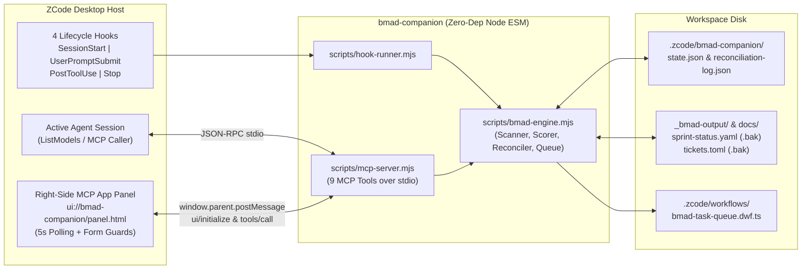

# BMAD Companion — Product Requirements Document

## Table of Contents

- [Document purpose](#document-purpose) — reader, scope, and source artifacts (`product-brief-bmad-companion.md`, `AGENTS.md`, `scripts/*.mjs`, `assets/panel.html`)
- [Vision](#vision) — ambient BMAD-METHOD orchestration, clean-session execution, and zero-drift delivery
- [Users and journeys](#users-and-journeys) — target personas, non-users, and end-to-end user journeys (`UJ-1`..`UJ-4`)
- [Glossary](#glossary) — canonical domain nouns (`Workspace Root`, `Static Tracker Progress`, `Smart AI Progress`, `Override Key`, `Model Profile Tier`, `Form Interaction Guard`, `Task Queue`)
- [Features and requirements](#features-and-requirements) — functional capabilities and checkable requirements (`FR-1`..`FR-22`) across 9 MCP tools, dual tracking, and 5s polling safety
- [Rules](#rules) — product-wide invariants (`RULE-1`..`RULE-6`) for zero dependencies, path confinement, and prompt formatting
- [Non-goals](#non-goals) — explicit exclusions preventing scope drift
- [MVP scope](#mvp-scope) — v0.5.2+ in-scope deliverables vs. deferred post-MVP capabilities
- [Success metrics](#success-metrics) — measurable targets and counter-metrics (`SM-1`..`SM-5`)
- [Quality and constraints](#quality-and-constraints) — CSP compliance, polling stability, and backup safety thresholds (`RULE-7`..`RULE-10`)
- [AI behavior and evaluation](#ai-behavior-and-evaluation) — model scoring heuristics, fallback chains, and non-hallucination boundaries
- [API contract and versioning](#api-contract-and-versioning) — JSON-RPC 2.0 MCP stdio schemas for all 9 tools and manifest version synchronization
- [SLOs and performance budgets](#slos-and-performance-budgets) — latency budgets for workspace scans, hooks, and OS session automation
- [Developer experience](#developer-experience) — zero-install setup, verification commands, and diagnostic patterns
- [Decisions](#decisions) — settled architectural and product trade-offs (`DEC-1`..`DEC-5`)
- [Assumptions](#assumptions) — tagged assumptions consolidated from planning (`A-1`..`A-4`)
- [Open questions](#open-questions) — remaining decisions with owners, revisit triggers, and blocked IDs (`OQ-1`..`OQ-3`)

---

## Document purpose

This Product Requirements Document (PRD) defines the initiative-altitude functional requirements, product rules, API contracts, and quality boundaries for **BMAD Companion** (`bmad-companion`). It is written for engineers, AI coding agents, QA reviewers, Sofia (`bmad-agent-po`), and Winston (`bmad-architecture`) to derive epics, stories, architecture spines, and zero-dependency test suites without relying on chat transcripts.

Source inputs:
- **Product Brief:** [`_bmad-output/planning-artifacts/product-brief-bmad-companion.md`](/D:/Developpement/Projets/Zcode%20plugins/bmad-companion/_bmad-output/planning-artifacts/product-brief-bmad-companion.md)
- **Repository Policies:** [`AGENTS.md`](/D:/Developpement/Projets/Zcode%20plugins/bmad-companion/AGENTS.md) and [`skills/bmad-companion/SKILL.md`](/D:/Developpement/Projets/Zcode%20plugins/bmad-companion/skills/bmad-companion/SKILL.md)
- **Codebase Baseline:** [`scripts/bmad-engine.mjs`](/D:/Developpement/Projets/Zcode%20plugins/bmad-companion/scripts/bmad-engine.mjs), [`scripts/mcp-server.mjs`](/D:/Developpement/Projets/Zcode%20plugins/bmad-companion/scripts/mcp-server.mjs), [`scripts/hook-runner.mjs`](/D:/Developpement/Projets/Zcode%20plugins/bmad-companion/scripts/hook-runner.mjs), and [`assets/panel.html`](/D:/Developpement/Projets/Zcode%20plugins/bmad-companion/assets/panel.html)

---

## Vision

AI-native software engineering with the BMAD-METHOD breaks down when developers must memorize 30+ slash skills, hand-craft repetitive context prompts, guess which LLM tier fits each task, and manually update `sprint-status.yaml` or `tickets.toml` after every story build. Chronological chat threads hide where a repository stands across the 4 BMAD phases (1. Analysis & Ideation, 2. Planning & UX Design, 3. Solutioning & Architecture, 4. Implementation, QA & Ship) and tempt developers to chain multiple phases in one bloated context window.

**BMAD Companion** turns ZCode's right-side panel (`ui://bmad-companion/panel.html`, surface `bmad-companion`) into an ambient, zero-dependency command cockpit for any workspace. Driven by four lifecycle hooks (`SessionStart`, `UserPromptSubmit`, `PostToolUse`, `Stop`) and a 9-tool MCP stdio server, it inspects repository artifacts, test reports, and turn outcomes to synthesize contextual `/bmad-<skill> "<prompt>"` commands paired with the top-ranked enabled model from the user's active providers.

Developers can launch a recommended prompt into a clean session in one click (`Ctrl/Cmd+N` + `Ctrl/Cmd+V`), reconcile lagging YAML/TOML trackers against verified codebase delivery with automatic `.bak` backups, or enqueue an entire epic for automated execution via ZCode Dynamic Workflows (`.dwf.ts`) or separate session loops — all with zero external `npm` dependencies.

---

## Users and journeys

### Target Users
1. **Solo Vibe-Coder / Indie Builder (Alex):** Ships full-stack apps with AI agents; needs ambient next-step guidance, cost-optimal model routing, and 1-click clean-session launching without losing custom prompt edits during 5s polling.
2. **Structured Tech Lead / Senior Engineer (Maya):** Enforces PRD-to-Story traceability and TDD; needs Dual Progress Tracking (`Static Tracker Progress` vs. `Smart AI Progress`) and 1-click tracker reconciliation with `.bak` backups and audit logs.
3. **Multi-Agent Sprint Orchestrator (Devon):** Runs multi-story epics across multiple providers; needs a per-task Execution Queue with configurable review gates (`none`, `quick`, `thorough`) and automated workflow generation.

**Non-Users:** Non-MCP editors lacking JSON-RPC App Surfaces, or teams seeking a cloud-hosted SaaS issue tracker (Jira/Linear) for non-technical stakeholders.

### User Journeys

- **UJ-1 — Alex edits a recommended prompt while 5-second background polling runs and launches a clean session.**
  Alex finishes a Product Brief in ZCode. The `Stop` hook updates `.zcode/bmad-companion/state.json`, and the right-side panel displays three recommendations topped by `/bmad-prd "Create the comprehensive Product Requirements Document..."` paired with `new-provider/claude-opus-5-5-high`. Alex clicks the prompt `<textarea>` to add a constraint and opens the model `<select>` dropdown. While Alex is typing, the 5-second visibility timer calls `bmad_get_state`. Because `isUserInteractingWithForm()` detects active input/dropdown focus and `userEditedPrompts` / `userSelectedModels` track edits against the base command, the poll stashes `pendingWorkspaceState` without re-rendering or dropping Alex's cursor. When Alex blurs the control and clicks **🚀 Launch in New Session**, `bmad_prepare_new_session` copies the edited prompt, dispatches `Ctrl/Cmd+N` and `Ctrl/Cmd+V`, and pre-pastes the command into a fresh ZCode session composer.
  *Realized by: `FR-1`, `FR-2`, `FR-3`, `FR-4`, `FR-6`, `FR-12`, `FR-13`, `FR-14`, `FR-18`, `FR-19`.*

- **UJ-2 — Maya reconciles drifting static sprint trackers with verified codebase reality.**
  Maya opens a project where three stories in Epic 2 have completed story plans (`status: done`), passing test reports in `_bmad-output/implementation-artifacts/`, and recent commits, while `sprint-status.yaml` and `tickets.toml` still list them as `in-progress` or `backlog`. In the **Phases & Epics** tab, Maya sees **Static Tracker Progress: 30% (3/10)** vs. **Smart AI Progress: 60% (6/10 — 3 stories smart-reconciled)**. She previews changes via `bmad_reconcile_trackers({ dryRun: true })` and then triggers live reconciliation: the engine writes `sprint-status.yaml.bak` and `tickets.toml.bak`, updates story statuses and YAML header counters in place while preserving comments, appends an entry to `.zcode/bmad-companion/reconciliation-log.json`, and aligns both progress bars to 60%.
  *Realized by: `FR-2`, `FR-5`, `FR-10`, `FR-11`.*

- **UJ-3 — Devon queues an epic with per-task models and token-saving review gates.**
  Devon clicks **Queue Epic** (`bmad_queue_manage({ action: "add-epic", epicSlug: "epic-auth" })`). In the **Execution Queue** tab, Devon assigns `new-provider/claude-sonnet-5-5-high` to each task, sets `reviewMode: "quick"` on routine stories and `reviewMode: "thorough"` on token rotation, and selects `executionMode: "dynamic-workflow"`. Clicking **▶ Start Queue** (`action: "start-queue"`) compiles `.zcode/workflows/bmad-task-queue.dwf.ts` and `.zcode/bmad-companion/queue-step-updater.mjs`. As each task runs, lifecycle hooks and step updaters transition tasks from `queued` (`⏳`) to `running` (`🟢`) to `done`, auto-updating story completion in the panel.
  *Realized by: `FR-9`, `FR-15`, `FR-16`, `FR-20`, `FR-21`, `FR-22`.*

- **UJ-4 — Maya inspects an artifact's live git diff from the right-side panel.**
  After an agent edits `_bmad-output/planning-artifacts/prd-bmad-companion/prd-bmad-companion.md`, Maya opens the **Artifacts** tab and clicks **Inspect / Diff** (`bmad_inspect_artifact`) to view the content preview and working-tree `git diff` inline, then clicks **Open in Editor** (`bmad_open_artifact_file`) to launch it in her desktop editor under strict workspace path confinement.
  *Realized by: `FR-7`, `FR-8`, `FR-17`.*

---

## Glossary

| Term | Definition |
| :--- | :--- |
| **Workspace Root** | Resolved absolute project directory (`ZCODE_WORKSPACE_ROOT`, `ZCODE_PROJECT_DIR`, `CLAUDE_PROJECT_DIR`, or `process.cwd()`). All artifact operations are confined within this boundary. |
| **Static Tracker Progress** | Completion metrics (`declaredDoneStories`, `declaredOverallPct`) parsed from explicit statuses in BMAD v6 `sprint-status.yaml` / `sprint-status.yml` or BMAD v7 `tickets.toml` and epic frontmatter. |
| **Smart AI Progress** | Reconciled metrics (`smartDoneStories`, `smartOverallPct`, `reconciledStoriesCount`) computed by combining Static Tracker Progress with story plan status, passing test reports, retrospectives, git commits, and `storyOverrides` in `state.json`. |
| **Override Key** | Deterministic story key (`<epic-slug>#<story-num>`) used in `.zcode/bmad-companion/state.json` (`storyOverrides`) to persist AI-verified story statuses and evidence. |
| **Model Profile Tier** | One of four capability buckets used to score host models: `deep-reasoning` (🧠), `creative-ux` (🎨), `agentic-coding` (💻), and `planning-fast` (⚡). |
| **Form Interaction Guard** | Client-side state machine in `assets/panel.html` (`isUserInteractingWithForm()`, `selectOpenUntil`, `pendingWorkspaceState`, `userEditedPrompts`, `userSelectedModels`, `lastSectionSignatures`) preventing 5s polling from disrupting active user focus or edits. |
| **Task Queue** | Persisted multi-task execution ledger (`state.json -> taskQueue`) managed by `bmad_queue_manage`, storing ordered tasks with `model`, `reviewMode` (`none` \| `quick` \| `thorough`), `status`, and `executionMode`. |

---

## Features and requirements

### Feature 1: 9-Tool MCP Stdio Server & Panel Surface (`scripts/mcp-server.mjs`)

Realizes `UJ-1`, `UJ-2`, `UJ-3`, `UJ-4`. Serves `ui://bmad-companion/panel.html` (`text/html;profile=mcp-app`, `_meta["zcode/csp"].unsafeEval: false`) and 9 JSON-RPC tools over stdio.

- **FR-1 (`bmad_open_companion`):** The MCP server can open the right-side `bmad-companion` surface, optionally persist a `focus` string to `state.json`, scan the workspace, and return both a Markdown summary (`content`) and full workspace state (`structuredContent`).
- **FR-2 (`bmad_get_state`):** The MCP server can scan the workspace on demand (`refresh?: boolean`) and return `structuredContent` with project metadata, 4-phase progress, epic/story trees, dual progress metrics (`declaredOverallPct` vs. `smartOverallPct`), active models, ranked recommendations, artifacts, and `taskQueue`.
- **FR-3 (`bmad_update_advisor`):** The agent can push post-turn analysis (`headline`, `turnSummary`, `recommendations[]`), synchronize live `hostModels[]` from `ListModels` (overriding disk `~/.zcode/v2/provider_config.json`), and persist `storyStatusUpdates[]` (`overrideKey`, `status`, `reason`).
- **FR-4 (`bmad_prepare_new_session`):** The MCP server can copy a `/bmad-<skill> "<prompt>"` command to the OS clipboard, persist `lastLaunchedSession` metadata, and when `openDirectly !== false`, trigger OS keystroke automation (`win32` PowerShell `SendKeys` `^n` + `^v`, `darwin` `pbcopy` + `osascript`, `linux` `wl-copy`/`xclip`/`xsel` + `xdotool`) to open a clean ZCode session with the prompt pre-pasted in the composer.
- **FR-5 (`bmad_reconcile_trackers`):** The MCP server can synchronize BMAD v6 (`sprint-status.yaml` / `.yml`) and/or BMAD v7 (`tickets.toml` and epic frontmatter) files with Smart AI-verified story statuses, supporting `dryRun?: boolean`, `target?: "all" | "v6-yaml" | "v7-tickets"`, and `backup?: boolean` (default `true`).
- **FR-6 (`bmad_recommend_next`):** The MCP server can return up to 7 topic-filtered `/bmad-<skill> "<contextual prompt>"` recommendations with paired `recommendedModel` objects (plus up to 12 `matchingSkills`) for any requested `topic`.
- **FR-7 (`bmad_inspect_artifact`):** The MCP server can read any BMAD artifact by workspace-relative path (`relPath`) and return its metadata, content preview, and live `git diff` while rejecting paths outside `workspaceRoot`.
- **FR-8 (`bmad_open_artifact_file`):** The MCP server can open a workspace-confined BMAD artifact in the desktop editor (`cmd /c start`, `open`, or `xdg-open`) and return its content preview and `git diff`.
- **FR-9 (`bmad_queue_manage`):** The MCP server can manage the Multi-Task Execution Queue across 14 actions (`get`, `add`, `add-epic`, `update-item`, `set-review-mode`, `set-execution-mode`, `reorder`, `remove`, `clear`, `start-queue`, `start-task`, `complete-task`, `pause-queue`, `generate-workflow`) with per-task `model`, `reviewMode` (`none` | `quick` | `thorough`), and `executionMode` (`dynamic-workflow` | `separate-sessions`).

### Feature 2: Dual Progress Tracking & Safe Tracker Reconciliation (`scripts/bmad-engine.mjs`)

Realizes `UJ-2`. Detects and repairs drift between static trackers and delivered code.

- **FR-10 (Dual Static vs. Smart Progress Calculation):** On every scan, the engine can parse BMAD v6 and v7 artifacts using zero-dependency parsers (`parseFrontmatter`, `parseTomlBlocks`, `parseSprintStatusYaml`) to compute both `Static Tracker Progress` (`declaredDoneStories`, `declaredOverallPct`) and `Smart AI Progress` (`smartDoneStories`, `smartOverallPct`, `reconciledStoriesCount`) with an evidence string (`smartReason`) per upgraded story.
- **FR-11 (Non-Destructive Reconciliation & Audit Ledger):** When `reconcileWorkspaceTrackers` runs with `dryRun: false`, the engine can: (1) write `<tracker>.bak` before modifying any file (unless `backup: false`), (2) update story keys and summary headers in `sprint-status.yaml` and `tickets.toml` in place while preserving comments and indentation, and (3) append an audit record to `.zcode/bmad-companion/reconciliation-log.json`.

### Feature 3: 5-Second Polling Safety & Non-Destructive UI Rendering (`assets/panel.html`)

Realizes `UJ-1`. Guarantees live panel refreshes never disrupt active user editing.

- **FR-12 (5-Second Visibility-Gated Polling & Overlap Lock):** The panel can poll `bmad_get_state({ refresh: true })` every `5000ms` only when `document.visibilityState === "visible"`, serialized by an `isRefreshing` lock.
- **FR-13 (Form Interaction Guard & Deferred State Flush):** Whenever focus is inside `<textarea>` or `<input>`, or within `15000ms` of opening/navigating a `<select>` (`isUserInteractingWithForm()`), the panel must suppress DOM re-renders from background polls or `ui/notifications/tool-result`, stash payloads in `pendingWorkspaceState`, and flush via `flushPendingState()` upon `focusout`, `change`, `Escape`, or `Tab`.
- **FR-14 (User Edit Preservation & Section Signature Diffing):** The panel must preserve user edits in `userEditedPrompts` and `userSelectedModels` across polls whenever the server base command/model is unchanged, and compare JSON signatures (`lastSectionSignatures`) before updating `innerHTML` on any tab container.

### Feature 4: Multi-Task Execution Queue & Workflow Compiler (`scripts/bmad-engine.mjs`)

Realizes `UJ-3`. Orchestrates queued stories with configurable token-saving review gates.

- **FR-15 (Review-Mode Prompt Shaping):** The engine can compile each queued task's `effectivePrompt` according to `reviewMode`: `none` (oneshot + deterministic verification only), `quick` (oneshot + single self-review pass), or `thorough` (multi-lens BMAD code review gate).
- **FR-16 (Dual Execution Engine Generation):** On `start-queue` or `generate-workflow`, the engine can either compile `.zcode/workflows/bmad-task-queue.dwf.ts` + `.zcode/bmad-companion/queue-step-updater.mjs` (`dynamic-workflow`) or emit a sequential `CreateSession` + `WaitSessions` orchestration plan (`separate-sessions`).

### Feature 5: Dynamic 4-Tier Model Scorer & Lifecycle Hooks (`scripts/bmad-engine.mjs`, `scripts/hook-runner.mjs`)

Realizes `UJ-1`, `UJ-3`, `UJ-4`. Synchronizes recommendations, touched files, and model routing across turn boundaries.

- **FR-17 (Workspace-Confined Artifact Discovery & Diffing):** The scanner can walk `_bmad-output/`, `docs/`, `AGENTS.md`, and `CONTEXT.md` (max depth 4) and compute per-artifact git status and `git diff` previews with normalized `/` paths confined to `workspaceRoot`.
- **FR-18 (Dynamic 4-Tier Host Model Scoring):** The engine can resolve enabled models from `state.json -> hostModels` (via `ListModels`) or `~/.zcode/v2/provider_config.json`, score each model against the skill's `modelProfile` (`deep-reasoning`, `creative-ux`, `agentic-coding`, `planning-fast`), and return the top `providerId/modelId`, tier label, and rationale.
- **FR-19 (`SessionStart` Hook Context Injection):** On `SessionStart`, `hook-runner.mjs` can scan the workspace and output `additionalContext` with smart-vs-static metrics, active provider counts, top 3 `/bmad-<skill> "<prompt>"` commands with recommended models, and companion rules.
- **FR-20 (`UserPromptSubmit` Hook & Queue Auto-Start):** On `UserPromptSubmit`, `hook-runner.mjs` can store `lastUserPrompt`, reset `recentTouchedFiles`, and auto-transition a matching queued task to `running` (`start-task`).
- **FR-21 (`PostToolUse` Hook File Tracking):** On `PostToolUse` (`Write`, `Edit`, `MultiEdit`), `hook-runner.mjs` can record up to 15 workspace-relative paths in `recentTouchedFiles`.
- **FR-22 (`Stop` Hook Turn Synthesis & Queue Auto-Advance):** On `Stop`, `hook-runner.mjs` can increment `turnCount`, store `lastAssistantMessage`, auto-complete a running single-session queued task (`complete-task`), and optionally invoke `BMAD_COMPANION_OPENAI_KEY` (`4500ms` timeout) for LLM turn synthesis.

---

## Rules

- **RULE-1 (Zero External Dependencies):** Runtime scripts (`scripts/*.mjs`) must use only Node.js 18+ built-in modules (`node:*`) with zero external `npm` dependencies.
- **RULE-2 (Never Emit Bare Skill Names):** Every recommendation must follow `/bmad-<skill> "<workspace-specific contextual prompt>"` paired with a `providerId/modelId` recommendation.
- **RULE-3 (Workspace Path Confinement):** All artifact reads, external opens, and tracker writes must resolve inside `workspaceRoot` with normalized `/` paths, rejecting `..` traversal.
- **RULE-4 (Single State Persistence Gateway):** All `.zcode/bmad-companion/state.json` writes must pass through `savePersistedState(workspaceRoot, partial)`.
- **RULE-5 (Upstream Skill Immutability):** Never hand-edit `.agents/skills/`, `.zcode/skills/`, or `skills-lock.json`; plugin-owned skills live only in `skills/bmad-companion/`.
- **RULE-6 (Version Tri-Sync):** Keep `version` and descriptions synchronized across `.zcode-plugin/plugin.json`, `../marketplace.json`, and `serverInfo.version` in `scripts/mcp-server.mjs`.

---

## Non-goals

1. **No Autonomous Git Commits, Branching, or Remote Pushes:** Reads git metadata and updates local trackers, but never runs `git commit`, `git checkout`, or `git push`.
2. **No `window.zcode` Bridge in Panel UI:** `assets/panel.html` uses only the MCP Apps `window.parent.postMessage` JSON-RPC 2.0 bridge (`ui/initialize`, `tools/call`, `ui/message`, `ui/update-model-context`).
3. **No Cloud Telemetry:** All state remains local under `.zcode/bmad-companion/`; optional LLM synthesis on `Stop` runs only if the user sets `BMAD_COMPANION_OPENAI_KEY`.
4. **No Non-ZCode Webview Ports in v0.5.x:** Standalone VS Code or JetBrains extensions are out of scope.

---

## MVP scope

### In Scope (`v0.5.2+` Baseline)
- **9 MCP Stdio Tools:** `bmad_open_companion`, `bmad_get_state`, `bmad_update_advisor`, `bmad_prepare_new_session`, `bmad_reconcile_trackers`, `bmad_recommend_next`, `bmad_inspect_artifact`, `bmad_open_artifact_file`, and `bmad_queue_manage`.
- **Dual Progress Engine & Reconciler:** BMAD v6 YAML + v7 TOML/Markdown parsers, evidence evaluator, `.bak` backup creation, and `.zcode/bmad-companion/reconciliation-log.json` audit trail.
- **5-Tab Right-Side Cockpit (`assets/panel.html`):** Next Prompts, Execution Queue, Phases & Epics, Catalog, and Artifacts Diff/Preview, with light/dark themes and 5s polling form-interaction guards.
- **4 Lifecycle Hooks & 4-Tier Model Router:** `SessionStart`, `UserPromptSubmit`, `PostToolUse`, `Stop`, plus live `ListModels` synchronization.

### Out of Scope (Deferred)
- **AST Architecture Drift Checker (`v1.0`):** Real-time AST verification against `ARCHITECTURE-SPINE.md`.
- **Cross-Plugin Event Bus with Vibe Debrief (`v1.0`):** Direct message passing between `bmad-companion` and `vibe-debrief` surfaces.
- **Headless CI CLI Gate (`v0.6`):** Standalone CLI flag for GitHub Actions tracker drift checks (`OQ-2`).

---

## Success metrics

| ID | Metric | Baseline | Target | Validates | Counter-Metric (Guardrail) |
| :--- | :--- | :--- | :--- | :--- | :--- |
| **SM-1** | **Contextual Prompt Completeness** | Bare `/bmad-*` commands | **100%** match `/^\/bmad-[a-z0-9-]+\s+".+"$/` with a valid `providerId/modelId` | `FR-3`, `FR-6`, `FR-18`, `RULE-2` | Local scan & recommendation latency $\le 250\text{ms}$ (`SM-4`). |
| **SM-2** | **Polling Form-State Preservation** | 5s DOM re-render drops focus | **0** dropped keystrokes, focus losses, or lost prompt/model edits during 5s polling | `FR-12`, `FR-13`, `FR-14`, `RULE-9` | Deferred flush after `focusout`/`change` $\le 100\text{ms}$. |
| **SM-3** | **Tracker Reconciliation Safety** | Manual YAML/TOML drift | **100%** syntactic validity of reconciled files + **100%** `.bak` creation when `backup !== false` | `FR-5`, `FR-10`, `FR-11`, `RULE-8` | Zero deletion of existing comments or unrelated keys. |
| **SM-4** | **Clean-Session Launch Velocity** | 30–60s manual tab setup | **< 5 seconds** from turn end to pre-pasted prompt in a new ZCode session | `FR-4`, `FR-19` | Zero unconfirmed auto-submissions in single-launch mode. |
| **SM-5** | **Queue Review-Gate Fidelity** | Full review on trivial tasks | **100%** adherence to `reviewMode` (`none`, `quick`, `thorough`) in generated plans | `FR-9`, `FR-15`, `FR-16` | 100% state synchronization between `taskQueue` and `storyOverrides`. |

---

## Quality and constraints

- **RULE-7 (Strict MCP App CSP Compliance):** `assets/panel.html` must run under `csp.unsafeEval: false` with zero external CDN dependencies, zero `eval()`, and `escapeHtml()` on all dynamic content.
- **RULE-8 (Tracker Backup & Dry-Run Guarantee):** `reconcileWorkspaceTrackers` must not write disk files when `dryRun: true`, and must write `<file>.bak` before modifying any tracker when `backup !== false`.
- **RULE-9 (5s Polling Non-Interference Threshold):** Background polling (`5000ms`) must skip execution if `isRefreshing`, hidden, or `isUserInteractingWithForm()`, and stash mid-flight results in `pendingWorkspaceState`.
- **RULE-10 (Bounded File System & Git Scanning):** `scanBmadWorkspace` must cap directory depth at `4`, cap heuristic file reads at `24KB`–`30KB`, and enforce a `2500ms` timeout on `git` subprocesses.

---

## AI behavior and evaluation

1. **Deterministic Primary Path, Optional LLM Secondary Path:**
   - All workspace scanning, story evidence reconciliation, and 4-tier model scoring in `scripts/bmad-engine.mjs` run deterministically offline.
   - Optional LLM synthesis in `scripts/hook-runner.mjs` (`tryOptionalAiTurnSynthesis`) runs only on `Stop` when `BMAD_COMPANION_OPENAI_KEY` or `OPENAI_API_KEY` is set, bounded by `AbortSignal.timeout(4500)`, falling back silently on failure.
2. **4-Tier Model Scoring (`scoreModelForProfile`):**
   - Excludes models with `enabled === false` or `disabledReason`.
   - Ranks enabled models by capability profile:
     - `deep-reasoning`: `claude-opus-5-5-high`, `claude-opus-4-6-thinking`, `qwen4-max`, `deepseek-v4-pro` (high/max reasoning).
     - `creative-ux`: `gemini-4-hydrogen-xhigh`, `claude-sonnet-5-5-high` (vision & design ergonomics).
     - `agentic-coding`: `claude-sonnet-5-5-high`, `claude-opus-5-5-high`, `deepseek-v4-pro`, `glm-5.3` (agentic coding & TDD).
     - `planning-fast`: `gemini-4-argon-high`, `gemini-3.8-flash-high`, `qwen3.8-flash` (fast high-context synthesis).
3. **Smart Story Status Evidence Rules:**
   - Upgrades `smartStatus` to `done` only when verified by: (a) `storyOverrides[overrideKey].status === "done"`, (b) story plan status marked `done`/`completed`/`shipped`, (c) passing implementation/test report (`failCount === 0`), or (d) completed epic retrospective. Failing test reports (`failCount > 0`) hold status at `in-progress`/`review` and trigger a high-priority remediation recommendation.

---

## API contract and versioning

### 1. MCP Protocol & Resource Surface
- **Protocol:** JSON-RPC 2.0 over stdio; `initialize` echoes the client's `params.protocolVersion` with server fallback `"2025-11-25"` (the panel sends `"2026-01-26"`), `serverInfo: { name: "bmad-companion", version: "0.5.3" }` (`RULE-6`).
- **Resource:** `uri: "ui://bmad-companion/panel.html"`, `mimeType: "text/html;profile=mcp-app"`, `_meta: { "zcode/csp": { unsafeEval: false } }` on `resources/list` and `resources/read` (tool `_meta.ui` carries `{ resourceUri, surface: "bmad-companion", visibility }`).

### 2. 9 MCP Tools Contract Summary

| Tool Name | Read-Only | Required Inputs | Optional Inputs | Structured Output (`structuredContent`) |
| :--- | :---: | :--- | :--- | :--- |
| `bmad_open_companion` (`FR-1`) | `true` | *(none)* | `focus?: string` | Full `ScanResult` + opens `bmad-companion` surface |
| `bmad_get_state` (`FR-2`) | `true` | *(none)* | `refresh?: boolean` | Full `ScanResult` (`metrics`, `phases`, `epics`, `recommendations`, `availableModels`, `taskQueue`, `artifacts`) |
| `bmad_update_advisor` (`FR-3`) | `false` | *(none)* | `headline?`, `turnSummary?`, `recommendations?[]`, `hostModels?[]`, `storyStatusUpdates?[]` | Updated `ScanResult` with merged overrides and `hostModels` |
| `bmad_prepare_new_session` (`FR-4`) | `false` | `prompt`, `model` | `skill?`, `title?`, `openDirectly?` | `{ prompt, model, skill, title, requestedAt, copied, openedDirectly, pasted, method, error? }` |
| `bmad_reconcile_trackers` (`FR-5`) | `false` | *(none)* | `dryRun?`, `target?`, `backup?` | `{ reconciledAt, dryRun, target, changesCount, updatedFiles[], changes[], before, after, newScan }` |
| `bmad_recommend_next` (`FR-6`) | `true` | *(none)* | `topic?: string` | `{ recommendations[], matchingSkills[] }` |
| `bmad_inspect_artifact` (`FR-7`) | `true` | `relPath: string` | *(none)* | `{ relPath, name, size, mtimeMs, lastModifiedIso, meta, diff, diffSource, preview, truncated }` |
| `bmad_open_artifact_file` (`FR-8`) | `false` | `relPath: string` | *(none)* | `{ relPath, name, size, mtimeMs, lastModifiedIso, meta, diff, diffSource, preview, truncated, openedExternally }` |
| `bmad_queue_manage` (`FR-9`) | `false` | `action: string` | `items?[]`, `epicSlug?`, `includeDone?`, `taskId?`, `sessionId?`, `model?`, `reviewMode?`, `applyToAll?`, `executionMode?`, `prompt?`, `direction?`, `onlyCompleted?`, `failed?`, `storyStatus?`, `summary?` | `{ ...ScanResult, queueActionResult: { action, taskQueue, generatedWorkflow } }` |

### 3. Versioning Policy
- Additive optional inputs or output keys are non-breaking (`0.5.x`). Renaming tools, removing `structuredContent.metrics` fields, or altering `overrideKey` format requires a `0.x.0` minor bump with state migration in `loadPersistedState`.

---

## SLOs and performance budgets

- **Workspace Scan (`scanBmadWorkspace`):** $\le 250\text{ms}$ (p95) for up to 500 artifacts (`RULE-10`).
- **Stdio Tool Call Latency (`bmad_get_state`, `bmad_recommend_next`, `bmad_inspect_artifact`):** $\le 300\text{ms}$ (p95).
- **New-Session OS Automation (`bmad_prepare_new_session`):** $\le 1500\text{ms}$ (p95), bounded by hard child-process timeouts (`8000ms` Win32, `6000ms` macOS, `2500ms` Linux).
- **Hook Execution (`hook-runner.mjs`):** $\le 350\text{ms}$ (p95) for deterministic hooks; $\le 4800\text{ms}$ when optional `Stop` LLM synthesis is enabled.

---

## Developer experience

- **Zero-Install Runtime (`RULE-1`):** Runs directly via Node 18+ ESM without `npm install`.
- **Verification Commands:**
  - Syntax check: `node --check scripts/bmad-engine.mjs && node --check scripts/mcp-server.mjs && node --check scripts/hook-runner.mjs`
  - Stdio smoke check: send `initialize`, `tools/list`, and `resources/read` over stdin to `node scripts/mcp-server.mjs`.
- **Graceful Degradation:** Missing `_bmad-output/` initializes Phase 1 onboarding recommendations; blocked OS synthetic keystrokes fall back cleanly to clipboard copy (`copied: true`) with an instructional toast.

---

## Decisions

- **DEC-1 — Standardize All 9 MCP Tools (Including `bmad_queue_manage`) in PRD Scope:** Included `bmad_queue_manage` (`FR-9`, `FR-15`, `FR-16`, `SM-5`) alongside the original 8 tools so the PRD matches the full working tree implementation. *Beat: Omitting `bmad_queue_manage` and leaving the Execution Queue undocumented.*
- **DEC-2 — Zero External NPM Dependencies (`RULE-1`):** Implemented dependency-free YAML, TOML, and Frontmatter parsers in `scripts/bmad-engine.mjs`. *Beat: Adding `js-yaml` / `toml` dependencies requiring `npm install`.*
- **DEC-3 — Client-Side Form Guards & Signature Diffing (`FR-12`..`FR-14`):** Used `isUserInteractingWithForm()`, `pendingWorkspaceState`, `userEditedPrompts`, and `lastSectionSignatures` over 5s `postMessage` polling. *Beat: Unconditional `innerHTML` replacement or spawning a WebSocket server.*
- **DEC-4 — Read-Only Smart Scan + Explicit Reconcile Action (`FR-10`, `FR-11`):** Computed `Smart AI Progress` in memory during scans and mutated `sprint-status.yaml` / `tickets.toml` only on explicit `bmad_reconcile_trackers` calls with `.bak` backups (`RULE-8`). *Beat: Silently mutating tracker files during `bmad_get_state`.*
- **DEC-5 — Dual Queue Execution Modes (`FR-16`):** Supported both `.dwf.ts` Dynamic Workflows and `CreateSession` + `WaitSessions` loops in `bmad_queue_manage`. *Beat: Locking users into a single orchestration mode.*

---

## Assumptions

- **A-1 (`FR-1`, `FR-12`, `RULE-7`):** ZCode Desktop supports `ui.surfaces` (`surface: "bmad-companion"`) and relays `window.parent.postMessage` JSON-RPC 2.0 calls to `scripts/mcp-server.mjs`.
- **A-2 (`FR-4`, `SM-4`):** Host OS user space permits clipboard utilities (`powershell.exe`, `pbcopy`, `wl-copy`/`xclip`) and falls back gracefully when synthetic keystrokes (`SendKeys`, `osascript`, `xdotool`) are restricted.
- **A-3 (`FR-10`, `FR-11`):** Target workspaces use BMAD v6 (`sprint-status.yaml`, `epics.md`) or BMAD v7 (`tickets.toml`, `initiative-*/`, `tickets/epic-*/`) layouts.
- **A-4 (`FR-3`, `FR-18`):** Host models are discoverable via `ListModels` passed to `bmad_update_advisor({ hostModels })` or `~/.zcode/v2/provider_config.json`.

---

## Open questions

| ID | Question | Owner | Needed By | Blocks |
| :--- | :--- | :--- | :--- | :--- |
| **OQ-1** | **Branch-Scoped `state.json`:** Should `.zcode/bmad-companion/state.json` partition `storyOverrides` and `taskQueue` by active Git branch? | Architect (`bmad-architecture`) | `v0.6.0` | Multi-branch state isolation epic |
| **OQ-2** | **Headless CI Drift Check Flag:** Should `scripts/bmad-engine.mjs` expose `--verify-trackers` for non-zero CI exit on tracker drift? | QA (`bmad-qa-generate-e2e-tests`) | `v0.6.0` | CI verification story |
| **OQ-3** | **Workspace Model Routing Policy File:** Should repositories support `.zcode/bmad-companion/routing.json` to pin models per skill or tier? | PM (`bmad-agent-pm`) | `v1.0.0` | Team model governance story |
