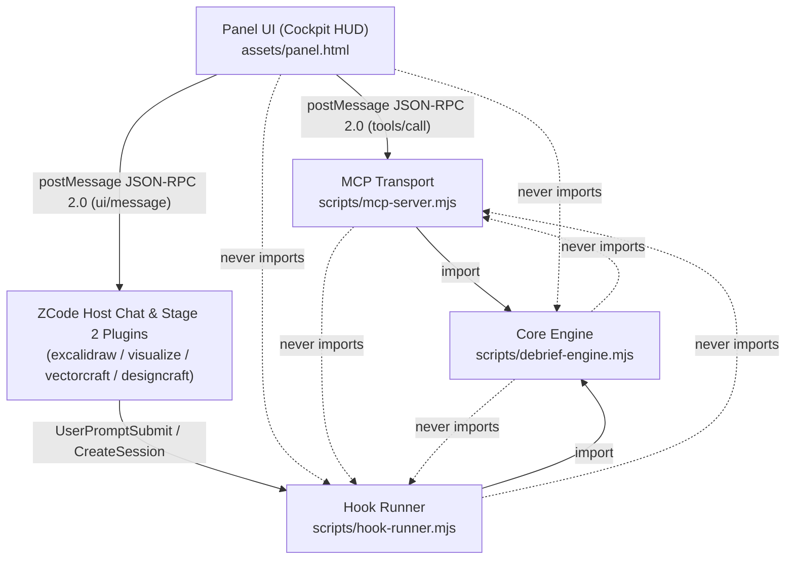
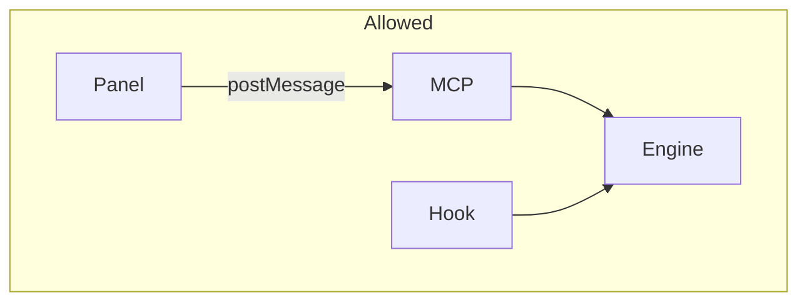
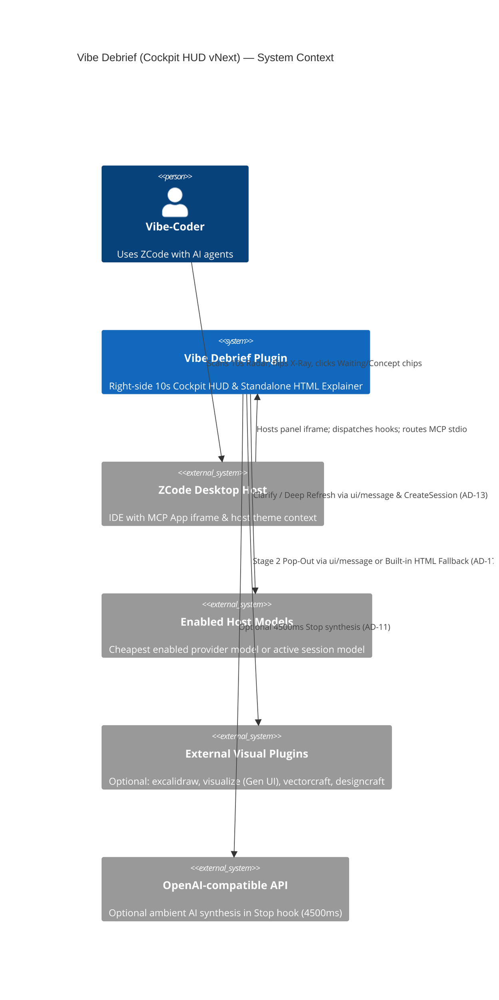
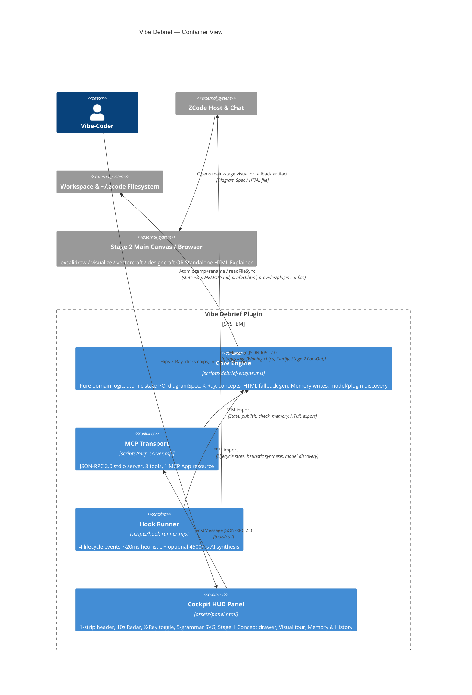
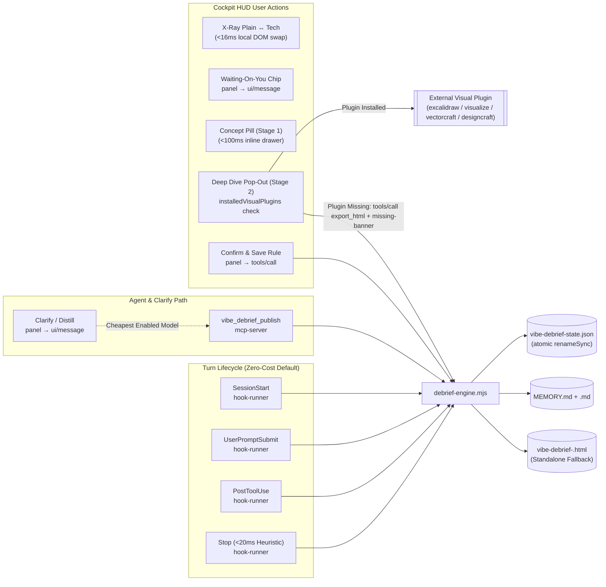

# Architecture Spine — vibe-debrief

## Design Paradigm

**Strict-Layered (4-Layer Unidirectional)** — four runtime layers with one-way dependency flow, exclusive runtime concerns, and a message-only Stage 2 pop-out boundary:



Each runtime layer maps to exactly one primary runtime file. The Engine is the shared pure/persistence dependency; MCP and Hook are siblings that never import each other; the Panel communicates with MCP and the ZCode Host exclusively via `window.parent.postMessage`.

## Invariants & Rules

### AD-1 — Strict 4-Layer Separation `[ADOPTED]`

- **Binds:** all (`R1`–`R12`, `C2`)
- **Prevents:** Cross-layer coupling that breaks independent `node:test` execution (`R8`) and `stdout` isolation (`C2`).
- **Rule:** Four runtime layers, each in exactly one primary runtime file. Layer concerns are exclusive:
  - **Core Engine** (`scripts/debrief-engine.mjs`): Pure domain logic, additive schema normalization, file I/O, state schemas, multi-grammar `diagramSpec` & deterministic scene builders, standalone HTML artifact generation, Memory writes, and host model/plugin discovery.
  - **MCP Transport** (`scripts/mcp-server.mjs`): JSON-RPC 2.0 stdio protocol, tool dispatch (8 tools), resource serving (`ui://vibe-debrief/panel.html`).
  - **Hook Runner** (`scripts/hook-runner.mjs`): ZCode lifecycle event handling (`SessionStart`, `UserPromptSubmit`, `PostToolUse`, `Stop`).
  - **Panel UI** (`assets/panel.html`): Self-contained MCP App Cockpit HUD iframe rendering via `postMessage` bridge.

### AD-2 — Unidirectional Dependency Flow `[ADOPTED]`

- **Binds:** all (`C2`, `R8`)
- **Prevents:** Circular dependencies; requiring MCP stdio setup or hook `stdin` to unit-test Engine logic via `node --test`.
- **Rule:** Dependencies flow strictly downward:
  - `mcp-server.mjs` → `debrief-engine.mjs` ✅
  - `hook-runner.mjs` → `debrief-engine.mjs` ✅
  - `panel.html` → MCP server & ZCode Host (via `postMessage` only) ✅
  - Engine never imports MCP, Hook, or Panel. MCP never imports Hook. Hook never imports MCP. Panel never imports any `.mjs` file.



### AD-3 — Stdout Isolation `[ADOPTED]`

- **Binds:** `RULE-4`, `C2`, `R1`, `R2`, `R8`, `FR-9`–`FR-13`
- **Prevents:** Debug logging corrupting JSON-RPC frames or hook JSON output.
- **Rule:**
  - `mcp-server.mjs`: `stdout` reserved for JSON-RPC 2.0 response/error frames (`sendResponse`, `sendError`). Never `console.log` to `stdout`.
  - `hook-runner.mjs`: `stdout` reserved for a single JSON line per invocation (`{}` or `{ additionalContext }`). Never `console.log` to `stdout`. Diagnostics, if any, use `stderr` only.
  - `debrief-engine.mjs`: Never reads `stdin`, never writes `stdout`. Zero `process.stdin`, `process.stdout`, or `console.log` calls. Only `process.env` and `process.cwd()` are referenced.

### AD-4 — Zero External Dependencies `[ADOPTED]`

- **Binds:** `RULE-2`, `C1`, `R8`, `R12`, all files
- **Prevents:** Supply-chain risk, install friction, bundler requirement.
- **Rule:**
  - Backend and test `.mjs` files import only `node:` built-ins (`node:fs`, `node:path`, `node:os`, `node:readline`, `node:url`, `node:test`, `node:assert/strict`, `node:child_process`). No `package.json`, no `node_modules`.
  - `panel.html` and standalone HTML artifacts load zero external `<script>`, `<link>`, icon fonts, or CDN resources. All CSS, multi-grammar SVG, and Canvas 2D rendering is inline.
  - `hook-runner.mjs` uses Node 18+ built-in `fetch` for optional AI synthesis — no polyfill or npm package.

### AD-5 — Engine Owns Persistent State, Atomic Writes & Additive vNext Normalization `[ADOPTED]`

- **Binds:** `R7`, `R9`, `C6`, `C7`, `FR-2`, `FR-3`, `FR-4`, `FR-5`, `FR-8`, `FR-25`–`FR-28`, `OQ-5`
- **Prevents:** Split persistence logic, torn concurrent writes (`R9`), direct disk writes outside Engine, and incompatible `v0.2.0`/`v0.3.0` vs. `v0.4.0` Cockpit HUD state snapshots.
- **Rule:** `debrief-engine.mjs` exclusively owns all file I/O, host discovery, and canonical state builders:
  - `loadPersistedState` / `savePersistedState` → `<workspaceRoot>/.zcode/vibe-debrief-state.json` (seeds `createDefaultState` + `createWelcomeDebrief` when missing or corrupt; ignores write failures gracefully on read-only workspaces).
  - **Atomic Write Contract (`v0.3.0` `R9`):** `savePersistedState` writes JSON to a sibling temporary file (`vibe-debrief-state.<pid>.<timestamp>.tmp`) and atomically replaces `vibe-debrief-state.json` via `renameSync` (with safe fallback/cleanup on Windows `EPERM`/`EXDEV`) so concurrent MCP and Hook processes never leave a torn or partial file (`<= 50ms` budget `C6`).
  - `confirmAndSaveLessonToZCodeMemory` → `<memoryDir>/<slug>.md` + `MEMORY.md` (falls back to `<workspaceRoot>/.zcode/memory/` if `~/.zcode/cli/memories` is unwritable).
  - `saveStandaloneHtmlArtifact(workspaceRoot, panelState, options)` → `<outDir>/vibe-debrief-<timestamp>.html` (`ZCODE_VISUALIZATION_DIR` or `<workspaceRoot>/.zcode/vibe-debrief-artifacts/`), supporting optional `{ conceptSlug, targetPlugin }` focus metadata for Stage 2 fallback exports.
  - **Host Model & Visual Plugin Discovery:**
    - `discoverCheapestEnabledModels` (with `discoverLightweightGeminiModels` retained as a backward-compatible export alias) inspects `~/.zcode/v2/` (`provider_config.json`, `setting.json`, `credentials.json`) across all enabled providers to rank fast/cheapest models, falling back to `"active-session"` when no provider config is present (while preserving `recommendedGeminiModel` in `panelState` for `v0.2.0`/`v0.3.0` callers).
    - `discoverInstalledVisualPlugins` inspects `~/.zcode/cli/plugins/` (`cache/`, installed manifests, and `.mcp.json` server keys) and project skills to return `installedVisualPlugins: Array<"excalidraw" | "visualize" | "vectorcraft" | "designcraft">`. It maps the ZCode `design` plugin bundle (or `.mcp.json` servers `vectorcraft`/`designcraft`) to `"vectorcraft"` and `"designcraft"`, and skill-based `visualize` (`0.1.2+`) to `"visualize"`.
  - **Additive Schema Normalization (`OQ-5`):** `ensureDebriefEnriched(debrief, state)` upgrades any `v0.2.0`/`v0.3.0` debrief snapshot in memory by populating `verdict`, `waitingOnYou`, `choices`, `xray`, `diagramSpec` (sync-aliased with legacy `diagram`), `microBlocks`, `concepts`, `heuristicConfidence`, `rawQuote`, `minimalMode`, and `explainerScenes` alongside legacy `bugReport`/`implementationReport` and `proofClaims` (with optional `detail` snippet). Bounded caps hold (`history` ≤ 15, `recentTouchedFiles` ≤ 15, `confirmedLessons` ≤ 50, `diagramSpec.nodes` ≤ 6, `concepts` ≤ 6, `waitingOnYou.chips` ≤ 4).
  - Panel has zero disk access (no inline diff editing or workspace file write-back).

### AD-6 — CSP, XSS Safety & Shared Theme-Token Contract `[ADOPTED]`

- **Binds:** `RULE-3`, `C3`, `R10`, `FR-8a`, `FR-25`
- **Prevents:** XSS in MCP App iframe; CSP `unsafeEval` violations; raw HTML injection via `.sym` badges; illegible dark-hardcoded SVG/Canvas under Field Desk Light (`R10`).
- **Rule:**
  - `panel.html` is served with `_meta["zcode/csp"].unsafeEval: false`.
  - No `eval()`, `new Function()`, or inline `onclick=`/`onchange=` attributes anywhere in `panel.html` or `generateStandaloneHtmlArtifact`.
  - All dynamic strings interpolated into HTML or SVG markup use `escapeHtml()` (escapes `&`, `<`, `>`, `"`). `xray.plain` and `xray.tech` strings are stored as raw unescaped text — never pre-baked HTML; `.sym` symbol badges are rendered by escaping text first and wrapping matched `xray.tech.symbols` / `paths` tokens in `<span class="sym">` at render time.
  - `generateStandaloneHtmlArtifact` escapes `<` as `\u003c` inside embedded `<script>` JSON payloads.
  - **Shared Theme-Token Contract (`R10`):** Both `panel.html` and `generateStandaloneHtmlArtifact` define the same CSS custom property tokens from `DESIGN.md` for Dark HUD (`:root`) and Field Desk Light (`body.theme-light`, `html[data-theme="light"]`, and `@media (prefers-color-scheme: light)` in exports). Inline SVG builders and `<canvas>` 2D draw loops resolve stroke/fill tokens at render time via `getComputedStyle(document.documentElement)` (or CSS `var(--*)` on SVG attributes) — never hardcoded dark-only hexes (except fixed media stages `--explainer-stage-bg: #070b12` and `--excalidraw-stage-bg: #faf8f2`).

### AD-7 — Reading-Boundary, Language-Agnostic STE-80 & Technical Symbol Integrity `[ADOPTED]`

- **Binds:** `RULE-1`, `R3`, `R4`, `FR-14`, `FR-15`, `FR-21`
- **Prevents:** Agents dumbing down code or reasoning mid-task; translating or mutating code symbols; unverified claims marked as `verified`.
- **Rule:**
  - STE-80 clarity (`applySte100Polish`, `computeSte100Metrics`: score `40–99`, `STE-80` `>= 80`, `Clear` `65–79`, `Dense` `< 65`, sentence length `<= 22` words, Radar headline `<= 14` words, active voice, one idea per bullet) applies strictly at the Reading Boundary (`vibe_debrief_publish`, `Stop` hook synthesis, and `confirmAndSaveLessonToZCodeMemory`) — never to mid-task agent reasoning.
  - **Language-Agnostic Prose + Symbol Integrity:** Plain-mode STE-80 copy is written in the active project/conversation language (`state.language`, e.g., `"en"`, `"fr"`), while code identifiers, file paths, and CLI commands are preserved verbatim inside `.sym` code badges and `xray.tech` overlays — never translated or mutated.
  - **Strict Proof Discipline:** `proofClaims` marked `verified` (`ok` pill) must cite observed tool or file evidence (with optional monospace `detail`); unrun tests are banned from `verified` and must land in `uncertaintyAudit` or `unverified` (`risk` pill).

### AD-8 — 4-File Version Sync & Automated Gate `[ADOPTED]`

- **Binds:** `RULE-5`, `R12`, `C4`
- **Prevents:** Version drift between plugin manifest, server info, panel appInfo, and hook banner.
- **Rule:** Every version bump updates all four locations atomically and is verified by `scripts/check-version-sync.mjs` in the `node --test` suite (`R12`):
  1. `.zcode-plugin/plugin.json` → `version`
  2. `scripts/mcp-server.mjs` → `serverInfo.version`
  3. `assets/panel.html` → `appInfo.version`
  4. `scripts/hook-runner.mjs` → `additionalContext` banner string

### AD-9 — Panel–Host Communication Protocol & Settings Persistence `[ADOPTED]`

- **Binds:** `R1`, `C3`, `FR-4`, `FR-6`, `FR-8a`
- **Prevents:** Direct DOM access to host; network requests from panel; direct cross-plugin MCP calls from the sandboxed iframe; settings changes in `gear-popover` getting rejected by `additionalProperties: false` or lost on re-render.
- **Rule:** `panel.html` communicates exclusively via `window.parent.postMessage` JSON-RPC 2.0 (`PROTOCOL_VERSION = "2026-01-26"`). No in-panel multi-turn chat thread, no pan/zoom canvas inside the narrow sidebar, and no inline code-diff editor.
  - **Outbound `tools/call` (to Vibe Debrief MCP server, 8-tool surface unchanged):**
    - `vibe_debrief_get_state`
    - `vibe_debrief_set_persona`: input schema accepts optional `{ persona?, responseType?, ste100Enabled?, language?, preferredModel?, themePreference? }` and persists all supplied settings via `savePersistedState` so `gear-popover` changes survive re-renders and are visible to `hook-runner.mjs`.
    - `vibe_debrief_toggle_check`
    - `vibe_debrief_confirm_lesson`
    - `vibe_debrief_export_html`: input schema accepts optional `{ conceptSlug?: string | null, targetPlugin?: "excalidraw" | "visualize" | "vectorcraft" | "designcraft" | null }`.
    - `vibe_debrief_generate_explainer`
  - **Outbound `ui/message` (to ZCode Host chat):** Dispatches structured prompts for:
    1. `Distill` / `Clarify (Fast / Cheapest Model)` (`[Vibe Debrief — Deep Refresh]` / `[Vibe Debrief — Clarify]`)
    2. `Waiting On You` quick-reply chips (`action-chip`, `choice-item`, `inline-reply-box`)
    3. Stage 2 external visual plugin pop-outs (`excalidraw`, `visualize`, `vectorcraft`, `designcraft`) and missing-plugin install suggestions.
  - **Inbound:** `ping` (health check reply), `ui/notifications/host-context-changed` (updates host theme when `panelState.themePreference === "auto"`), `ui/notifications/tool-result` (state push).
  - Pending requests tracked via `rpcId` counter + `pendingRequests` Map with `15,000ms` timeout. Tool errors (`isError: true` or missing `structuredContent`) route to `hud-toast`, never `renderPanelState`.

### AD-10 — Single-State-Render Entry Point & Transient Cockpit UI State `[ADOPTED]`

- **Binds:** `R1`, `R11`, `FR-8a`
- **Prevents:** Partial UI updates, stale view/drawer state, render path fragmentation, or background `tool-result` pushes clobbering open drawers, forms, or `missing-banner`.
- **Rule:**
  - `panel.html` has one server-state render entry point: `renderPanelState(state)`, requiring a full `buildFullPanelState()` payload (`currentDebrief` present).
  - Server-owned `panelState` (`currentDebrief`, `history`, `confirmedLessons`, `zcodeMemory`, `language`, `preferredModel`, `themePreference`, `recommendedGeminiModel`, `recommendedModel`, `availableModels`, `installedVisualPlugins`) is strictly separated from panel-owned transient UI state:
    - `activeView` (`"hud"` | `"visual"` | `"memory"`)
    - `xrayMode` (`"plain"` | `"tech"`)
    - `hostTheme` (`"dark"` | `"light"`, resolved with `panelState.themePreference` `"auto"` | `"dark"` | `"light"`)
    - `selectedNodeId` (active SVG node inspector target)
    - `activeConceptSlug` (open `stage1-drawer` slug or `null`)
    - `missingPluginFallback` (`{ targetPlugin, conceptSlug, artifactPath } | null` — persists across `vibe_debrief_export_html` `tool-result` re-render so `missing-banner` remains visible)
    - `expandedProofIds` (`Set<string>` of open `proof-detail` drawers)
    - `showRawReply` (`boolean` toggle inside `unclear-box`)
    - `gearPopoverOpen` (`boolean`)
    - `lessonFormState` (`{ open: boolean, draftTitle: string, draftSummary: string, draftWhy: string, draftHow: string }`)
    - `minimalModeExpanded` (`boolean` override for `minimal-strip`)
    - `selectedWaitingChipId` (optimistic `.selected` state on `action-chip` / `choice-item`)
    - `playerState` (Canvas `playing`, `sceneIndex`, `speed`, `voiceEnabled`)
  - All tool results and `tool-result` notifications converge through `renderPanelState` → `renderHudView` (`renderRadarOrMinimal`, `renderMicroBlocks`), `renderVisualView`, `renderMemoryHistoryView`, preserving transient UI state across same-turn updates and resetting turn-scoped transient flags (`activeConceptSlug`, `missingPluginFallback`, `expandedProofIds`, `showRawReply`, `minimalModeExpanded`, `selectedWaitingChipId`) only when `currentDebrief.id` changes.
  - **Accessibility Floor (`R11`):** Every interactive custom element (`view-switcher` tabs, SVG `<g class="svg-node">`, `concept-pill`, `choice-item`, `proof-pill`, `history-item`) renders with semantic ARIA roles (`role="tablist"`, `role="tab"`, `role="button"`, `role="dialog"`, `role="status"` + `aria-live="polite"`), `tabindex="0"`, keyboard handlers (`Enter`/`Space`, `ArrowLeft`/`ArrowRight`, `Escape` closing `gear-popover`, `stage1-drawer`, or `lesson-form`), and honors `prefers-reduced-motion: reduce`.

### AD-11 — Never-Crash Hook Pattern `[ADOPTED]`

- **Binds:** `R2`, `C6`, `FR-9`–`FR-13`
- **Prevents:** Hook failure crashing the ZCode session lifecycle or blocking turn completion.
- **Rule:** `hook-runner.mjs` wraps every I/O path in `try/catch`:
  - `readStdinJson()`: returns `{}` on parse failure — never throws.
  - `synthesizeHeuristicDebrief()` runs unconditionally first (`<= 50ms` target latency `C6`, `< 20ms` nominal) — always produces a valid enriched debrief with `heuristicConfidence` (`0.0–1.0`).
  - `tryOptionalAiDebriefSynthesis()` enforces `AbortSignal.timeout(4500)` (`4,500ms`) and returns `null` on any error (timeout, HTTP, JSON parse) — AI failure is invisible.
  - Transcript reading, file path resolution, and unknown modes degrade silently to `{}`.

### AD-12 — Complexity Gate Backward-Compatibility, Anytime Curator Tour & Minimal Mode `[ADOPTED]`

- **Binds:** `R5`, `R8`, `FR-22`–`FR-24`
- **Prevents:** Breaking `v0.3.0` `R5`/`R8` complexity-gate unit tests; rigid `score >= 4` UI lockout blocking users from `[Animate]` / `Visual` on focused turns; trivial 1-line turns rendering empty diagrams or hiding low-confidence `unclear-box`.
- **Rule:**
  - **`R5`/`R8` Complexity Gate Preservation:** `assessWorkflowComplexity` preserves its `v0.2.0`/`v0.3.0` return contract (`level: "simple" | "complex"`, `score`, `reasons`, `shouldRenderExplainer: level === "complex"` when `score >= 4` or `complexityOverride === "complex"`), and `buildExplainerScenesIfComplex` keeps returning `[]` for `"simple"` turns so `v0.3.0` `R8` unit tests pass without conflict.
  - **Anytime Curator Tour (`v0.4.0`):** `ensureDebriefEnriched` populates `explainerScenes` via `buildExplainerScenesForDebrief` (`< 5ms` deterministic synthesis from `diagramSpec.nodes`/`edges`) whenever `minimalMode === false` (or when `vibe_debrief_generate_explainer` is called), so `Visual` (`explainer-stage`) and `[Animate]` in `powerup-dock` are always unlocked on non-minimal turns. When `complexity.level === "complex"` (`score >= 4`), `powerup-dock` highlights `[Animate]` with an active pulse badge.
  - **Tiny-Turn Minimal Mode Gate & `unclear` Precedence:** `ensureDebriefEnriched` computes `minimalMode: boolean` as `true` only when all four conditions hold: (1) trivial turn (`0–1` low-risk touched files, `complexity.score <= 1`, short response), (2) `waitingOnYou.state === "none"`, (3) `choices.length === 0`, and (4) `heuristicConfidence >= 0.55` (so low-confidence turns **never** collapse into `Minimal Mode · Verified` and always surface `unclear-box`). When `minimalMode === true` and transient `minimalModeExpanded === false`, `HUD` renders `minimal-strip` with a 1-click `Expand` toggle.

### AD-13 — Turn-Handoff, Debrief Ownership & Model-Agnostic Clarify Fallback `[ADOPTED]`

- **Binds:** `R2`, `FR-3`, `FR-10`, `FR-12`, `RULE-6`
- **Prevents:** `Stop` hook overwriting an agent-published debrief; hardcoded model names (`gemini-4-argon`) failing when a user runs non-Gemini providers; speculative heuristic guesses masquerading as high-confidence debriefs.
- **Rule:**
  - `UserPromptSubmit` clears `recentTouchedFiles`, `lastCommandExitZero`, and sets `agentPublishedThisTurn: false`.
  - `vibe_debrief_publish` sets `agentPublishedThisTurn: true`.
  - `Stop` checks `state.agentPublishedThisTurn && state.currentDebrief`: if `true`, it preserves `currentDebrief`, updates `lastAssistantMessage` and `turnCount`, clears the flag to `false`, and skips synthesis.
  - **Honest Uncertainty & Model-Agnostic Clarify (`unclear-box`):** When `heuristicConfidence < 0.55` on a heuristic `Stop` debrief, `minimalMode` is forced `false` and `microBlocks` includes `"unclear"` at the top so `HUD` renders `unclear-box` with a verbatim `rawQuote` snippet (`<= 280` chars), `Clarify (Fast / Cheapest Model)`, and `Show Raw Reply` instead of fabricating verification claims.
  - Clicking `Clarify` or `Distill` sends `[Vibe Debrief — Clarify]` / `[Vibe Debrief — Deep Refresh]` via `ui/message`. `UserPromptSubmit` intercepts either marker and injects Reading-Boundary delegation instructions: if a specific model is resolved (`state.preferredModel` override or top candidate from `discoverCheapestEnabledModels()`), it instructs `CreateSession` delegation to that model; if `recommendedModel === "active-session"`, it instructs the active session model directly — never hardcoding a single model ID.

### AD-14 — Declarative Multi-Grammar Diagram Spec `[ADOPTED]`

- **Binds:** `R4`, `FR-18`–`FR-20`, `OQ-5`
- **Prevents:** Incompatible diagram schemas between `debrief-engine.mjs`, `panel.html` (`svg-stage`), `generateStandaloneHtmlArtifact`, and Stage 2 external plugin handoffs; cross-lane edge corruption in `"before-after"` diagrams; unreadable node clutter in the `320–460px` sidebar.
- **Rule:**
  - `debrief-engine.mjs` synthesizes and normalizes a declarative `diagramSpec` on every debrief, kept sync-aliased with `debrief.diagram` (`debrief.diagramSpec === debrief.diagram` or mirrored fields) so `v0.2.0`/`v0.3.0` callers reading `debrief.diagram.nodes`/`edges` continue to work unchanged:
    - `grammar`: `"sequence"` | `"flow-diff"` | `"subway-map"` | `"before-after"` | `"decision-tree"`.
    - **Deterministic 4-to-5 Grammar Mapping:** When `grammar` is omitted, legacy `diagramType` maps deterministically:
      1. If `choices.length >= 2` or `diagramType === "decision-tree"` → `"decision-tree"`
      2. `"sequence"` → `"sequence"`
      3. `"state-flow"` → `"flow-diff"`
      4. `"cause-effect"` → `"before-after"`
      5. `"architecture"` (or default) → `"subway-map"`
    - `title`: plain STE-80 title + optional `techTitle`.
    - `viewBoxWidth`: fixed `460` (`viewBox="0 0 460 H"`) for fluid sidebar scaling without pan/zoom controls.
    - `groups`: optional `Array<{ id: string, label: string, lane: string }>` for `"subway-map"` and `"before-after"` containers.
    - `nodes`: capped at `<= 6` primary nodes (`id`, `label`, `techLabel`, `sublabel`, `role`, `file`, `risk`: `"low"` | `"medium"` | `"high"`, `status`: `"done"` | `"active"` | `"warning"` | `"pending"`, optional `lane`: `"before"` | `"after"` | `string` for `"before-after"` / `"subway-map"`, optional `branch`: `string` for `"decision-tree"`).
    - `edges`: sequential numbered edges (`stepNumber: 1..N`, `from`, `to`, `label`, `techLabel`, `risk`, `animated: boolean`). When auto-synthesizing omitted edges in `"before-after"` grammar, edges connect sequentially within the `"before"` lane and within the `"after"` lane without bridging the last `"before"` node into the first `"after"` node.
  - Both `panel.html` (`svg-stage`) and `generateStandaloneHtmlArtifact` render all 5 grammars from `diagramSpec` using pure inline SVG and kinetic `.dash-flow` stroke animation (disabled under `prefers-reduced-motion: reduce`).

### AD-15 — Dual-Coded X-Ray Payload, Composable Micro-Blocks & MCP Schema Pass-Through (`OQ-5`) `[ADOPTED]`

- **Binds:** `R1`, `R3`, `R4`, `FR-3`, `FR-14`–`FR-21`, `OQ-5`
- **Prevents:** Client-side `X-Ray: Plain ↔ Tech` flips triggering an LLM/RPC call; `mcp-server.mjs` rejecting or stripping `v0.4.0` fields on `vibe_debrief_publish`; mismatch between `microBlocks` ID list and top-level `Debrief` data slices.
- **Rule:**
  - **Dual-Coded X-Ray (`xray`):** Every normalized `Debrief` pre-packages raw unescaped `plain` (`{ headline, summaryBullets }`) and `tech` (`{ headline, summaryBullets, symbols, paths, commands, exitCodes, proofLines }`) representations, alongside `techLabel` on `diagramSpec.nodes`/`edges`, `waitingOnYou.chips`, and `techSubtext` on `choices`. Flipping `xray-toggle` in `panel.html` or standalone HTML toggles `data-xray-mode="plain|tech"` and swaps pre-bound escaped text and `.sym` chips in `< 16ms` with zero RPC or LLM invocation.
  - **Composable Micro-Blocks (`microBlocks`):** `microBlocks` is strictly an ordered `Array<"unclear" | "choices" | "diagram" | "proof-audit" | "concepts" | "lessons">` of block IDs that tells `panel.html` and `generateStandaloneHtmlArtifact` which top-level `currentDebrief` slices to compose below `radar-card`:
    - `"unclear"` → renders `unclear-box` from `heuristicConfidence` and `rawQuote`
    - `"choices"` → renders `choice-grid` from `currentDebrief.choices: ChoiceOption[]` (`{ id, key, title, plainSubtext, techSubtext, messagePrompt, picked?: boolean, tradeOffs?: Array<{ label: string, score: number }> }` where `score` is `0–100` for the `34×4px` meter bar)
    - `"diagram"` → renders `svg-stage` + `powerup-dock` from `currentDebrief.diagramSpec`
    - `"proof-audit"` → renders `proof-pill` row (with expandable `proof.detail`), `audit-row` (`uncertaintyAudit` with `💡→Rule` prefill), and `verificationChecklist`
    - `"concepts"` → renders `concept-pill` strip + inline `stage1-drawer` from `currentDebrief.concepts`
    - `"lessons"` → renders `lesson-card` list + inline `lesson-form` from `currentDebrief.lessonsLearned`
  - **Legacy & MCP Pass-Through Contract:** `vibe_debrief_publish` in `scripts/mcp-server.mjs` widens its `inputSchema` (allowing optional `verdict`, `minimalMode`, `heuristicConfidence`, `rawQuote`, `xray`, `waitingOnYou`, `choices`, `diagramSpec`, `microBlocks`, `concepts`, and `diagram.grammar` / 5-grammar `diagramType`) and forwards all supplied `v0.4.0` fields into `draftDebrief` before calling `ensureDebriefEnriched`. Legacy `responseType` (`"bug"` | `"implementation"`), `bugReport`, and `implementationReport` remain populated in every `Debrief` for `v0.2.0`/`v0.3.0` backward compatibility (`R1`, `R3`, `R8`).

### AD-16 — 5-State Waiting-On-You Radar & `ui/message` Action Dispatch `[ADOPTED]`

- **Binds:** `R1`, `FR-8a`, `OQ-5`
- **Prevents:** Users missing pending AI questions/choices/actions; conflating top-of-fold `radar-card` quick-action pills with full architectural `choice-grid` cards; panel attempting direct shell execution outside `ui/message`.
- **Rule:**
  - Every normalized `Debrief` includes `verdict` (`"Solved"` | `"Built"` | `"Explained"` | `"Blocked"` | `"Planned"`) and a `waitingOnYou` object with deterministic 5-state classification:
    - `state`: `"choice"` | `"action"` | `"reply"` | `"blocked"` | `"none"`
    - `label`: short status badge copy (`"Pick a Choice"`, `"Verify / Run"`, `"Answer Question"`, `"Blocked"`, `"All Clear"`)
    - `prompt`: concise 1-line callout
    - `chips`: array of `{ id, key, label, techLabel, messagePrompt, primary }` (max 4 quick-action chips rendered inside `radar-card`; when `state === "choice"` and `choices.length > 0`, `chips` mirror the top choice keys for 1-click reply)
    - `allowInlineReply`: `boolean` (`true` when `state === "reply"`, rendering `inline-reply-box`)
  - Clicking any `action-chip`, `choice-item`, or submitting `inline-reply-box` in `panel.html` dispatches `messagePrompt` (or the user's reply text) to the ZCode host via `postMessage` `ui/message`, sets transient `selectedWaitingChipId`, and displays a confirmation `hud-toast`.

### AD-17 — Two-Stage Concept Deep Dive Bridge & Mandatory Missing-Plugin HTML Fallback `[ADOPTED]`

- **Binds:** `R1`, `R6`, `C1`, `C3`, `FR-6`, `FR-8a`, `FR-25`, `OQ-5`
- **Prevents:** Launching heavy external visual plugins on accidental clicks; cramming full whiteboard editors into the `320–460px` sidebar; raw tool-not-found failures, missing 3-column Stage 2 explanations, or wasted LLM turns when an external visual plugin is not installed.
- **Rule:**
  - **Stage 1 — Inline Micro-Drawer (`< 100ms`, zero RPC):** `ensureDebriefEnriched` populates `concepts: ConceptItem[]` (capped at `<= 6` per turn). Each `ConceptItem` carries:
    - `slug`: kebab-case identifier
    - `label`: display term + `techSymbol`
    - `targetPlugin`: `"excalidraw"` | `"visualize"` | `"vectorcraft"` | `"designcraft"`
    - `stage1`: `{ definition: string, analogy: string, microVisualSpec: { type: "loop-3node" | "pipeline-3node" | "split-compare", nodes: string[] } }`
    - `stage2`: `{ howItWorks: string, keyTradeOff: string, inYourCodebase: string }` (the 3-column deep explanation cards required by `DESIGN.md` for Stage 2 and built-in HTML fallback at zero LLM cost)
    - `stage2Prompt`: structured delegation prompt for the external visual plugin.
    - Clicking a `concept-pill` opens `stage1-drawer` inline in `< 100ms` using local `currentDebrief.concepts` data — zero network, MCP, or external plugin call.
  - **Stage 2 — External Pop-Out or Mandatory Built-In HTML Fallback:** When the user clicks `Deep Dive & Pop Out ↗` in `stage1-drawer` (or an external surface button in `powerup-dock` where `conceptSlug` is `null`):
    1. `panel.html` checks `panelState.installedVisualPlugins.includes(targetPlugin)`.
    2. **If installed:** `panel.html` dispatches a structured `ui/message` containing the serialized `diagramSpec`, `stage2` summary, and `stage2Prompt` instructing the host agent to open the visual on the main ZCode stage via `targetPlugin`, and shows `hud-toast` (`"Sent to <Plugin>"`).
    3. **If missing / unavailable (Mandatory Fallback):** `panel.html` sets transient `missingPluginFallback = { targetPlugin, conceptSlug, artifactPath: null }` and immediately invokes `vibe_debrief_export_html` (`tools/call` with `{ conceptSlug, targetPlugin }`). `generateStandaloneHtmlArtifact` renders the full Stage 2 view (including the `stage2-popout` 3-column deep explanation grid `How It Works` / `Key Trade-off` / `In Your Codebase`, floating telemetry pill, and `missing-banner`). Upon receiving the `tools/call` response (`artifactPath`), `panel.html` updates `missingPluginFallback.artifactPath`, renders `missing-banner` inline with the clickable artifact path/link and a 1-click `Install <targetPlugin>` CTA (`ui/message`), and preserves `missing-banner` across the accompanying `tool-result` state push (`AD-10`).

## Canonical Data Contracts (`OQ-5` Schema Seed)

Additive `v0.4.0` Cockpit HUD fields on `Debrief` and `panelState` (all `v0.2.0`/`v0.3.0` keys remain intact and populated by `ensureDebriefEnriched`):

```json
{
  "panelState": {
    "projectName": "vibe-debrief",
    "workspaceRoot": "/abs/path/to/workspace",
    "activePersona": "vibe-mentor",
    "ste100Enabled": true,
    "language": "en",
    "preferredModel": "auto-cheapest",
    "themePreference": "auto",
    "recommendedGeminiModel": "new-provider/gemini-3.8-flash",
    "recommendedModel": "new-provider/gemini-3.8-flash",
    "availableModels": [
      { "id": "new-provider/gemini-3.8-flash", "providerId": "new-provider", "score": 10 }
    ],
    "installedVisualPlugins": ["excalidraw", "visualize", "vectorcraft", "designcraft"],
    "currentDebrief": {
      "id": "debrief-1763472000000",
      "responseType": "bug",
      "verdict": "Solved",
      "minimalMode": false,
      "heuristicConfidence": 0.92,
      "rawQuote": "",
      "tldrHeadline": "Fixed retry guard in webhook handler across 2 files.",
      "xray": {
        "plain": {
          "headline": "Fixed retry guard in webhook handler across 2 files.",
          "summaryBullets": ["Stop duplicate retries when webhook returns HTTP 500."]
        },
        "tech": {
          "headline": "Patched retryWebhook() guard in src/webhook.mjs and test/webhook.test.mjs.",
          "summaryBullets": ["Added MAX_RETRIES <= 3 guard before scheduling backoff timer."],
          "symbols": ["retryWebhook", "MAX_RETRIES"],
          "paths": ["src/webhook.mjs", "test/webhook.test.mjs"],
          "commands": ["node --test test/webhook.test.mjs"],
          "exitCodes": [0],
          "proofLines": ["PASS test/webhook.test.mjs (2/2 assertions)"]
        }
      },
      "waitingOnYou": {
        "state": "action",
        "label": "Verify / Run",
        "prompt": "Run the webhook retry test to confirm exit code 0.",
        "allowInlineReply": false,
        "chips": [
          {
            "id": "act-1",
            "key": "1",
            "label": "Run webhook retry test",
            "techLabel": "node --test test/webhook.test.mjs",
            "messagePrompt": "Please run `node --test test/webhook.test.mjs` and publish the updated Vibe Debrief.",
            "primary": true
          }
        ]
      },
      "choices": [
        {
          "id": "choice-A",
          "key": "A",
          "title": "Exponential Backoff with Jitter",
          "plainSubtext": "Spreads retries over time so bursts do not overload the server.",
          "techSubtext": "baseDelayMs * (2 ** attempt) + randomJitter(0..250)",
          "messagePrompt": "Let's proceed with Option A: Exponential Backoff with Jitter.",
          "picked": false,
          "tradeOffs": [
            { "label": "Safety", "score": 95 },
            { "label": "Speed", "score": 70 }
          ]
        }
      ],
      "diagramSpec": {
        "grammar": "flow-diff",
        "title": "Webhook Retry Guard Flow",
        "techTitle": "src/webhook.mjs::retryWebhook FlowDiff",
        "viewBoxWidth": 460,
        "groups": [{ "id": "g-api", "label": "API Layer", "lane": "api" }],
        "nodes": [
          {
            "id": "n1",
            "label": "Webhook Handler",
            "techLabel": "src/webhook.mjs::retryWebhook",
            "sublabel": "Retry guard added",
            "role": "API / Transport",
            "file": "src/webhook.mjs",
            "risk": "high",
            "status": "active",
            "lane": "api"
          }
        ],
        "edges": []
      },
      "microBlocks": ["choices", "diagram", "proof-audit", "concepts", "lessons"],
      "concepts": [
        {
          "slug": "idempotent-retry",
          "label": "Idempotent Retry",
          "techSymbol": "retryWebhook()",
          "targetPlugin": "visualize",
          "stage1": {
            "definition": "An operation that produces the same safe result even if called multiple times.",
            "analogy": "Like pressing an elevator call button: pressing it five times still calls one elevator.",
            "microVisualSpec": { "type": "loop-3node", "nodes": ["Request", "Dedup Key", "Safe State"] }
          },
          "stage2": {
            "howItWorks": "Checks idempotency key before executing retry logic and caps attempts at MAX_RETRIES.",
            "keyTradeOff": "Requires tracking request IDs in memory or storage across retry windows.",
            "inYourCodebase": "Enforced in src/webhook.mjs inside retryWebhook()."
          },
          "stage2Prompt": "Create an interactive simulation of idempotent webhook retry backoff and deduplication."
        }
      ]
    }
  }
}
```

## Consistency Conventions

| Concern | Convention |
| --- | --- |
| **Naming (files)** | Backend scripts: `<purpose>.mjs` in `scripts/`. Single UI file: `panel.html` in `assets/`. Verification suite: `<area>.test.mjs` in `tests/`. Hooks config: `hooks/hooks.json`. Plugin manifest: `.zcode-plugin/plugin.json`. |
| **Naming (exports)** | Engine exports: `camelCase` verbs (`loadPersistedState`, `buildDefaultDiagram`, `discoverCheapestEnabledModels`, `discoverLightweightGeminiModels`, `discoverInstalledVisualPlugins`). Constants: `UPPER_CASE` (`PERSONAS`). Tool names: `snake_case` with `vibe_debrief_` prefix. |
| **Naming (state keys)** | `camelCase` throughout (`currentDebrief`, `ste100Enabled`, `language`, `preferredModel`, `themePreference`, `agentPublishedThisTurn`, `waitingOnYou`, `choices`, `diagramSpec`, `microBlocks`, `installedVisualPlugins`). |
| **ESM & imports** | All `.mjs` files; explicit `node:` prefix on built-ins (`node:fs`, `node:path`, `node:test`). Relative imports for `./debrief-engine.mjs`. |
| **Data formats (IDs)** | Debrief IDs: `debrief-<Date.now()>`. Lesson & concept slugs: `slugify(title)` (lowercase, hyphens, max 48 chars). Check IDs: `chk-<index>`. Action chip IDs: `act-<index>` / `choice-<key>`. |
| **Data formats (timestamps)** | ISO 8601 strings via `new Date().toISOString()`. |
| **Data formats (errors)** | MCP tool errors: `{ isError: true, content: [{ type: "text", text }] }` (JSON-RPC envelope succeeds). JSON-RPC protocol errors: `-32601` method not found, `-32602` invalid params, `-32603` internal error. |
| **State & schema evolution** | Engine: atomic read-modify-write via `loadPersistedState` → merge patch → temp-file + `renameSync` in `savePersistedState` (`R9`). Additive backward-compatibility via `createDefaultState` + `ensureDebriefEnriched` (`OQ-5`). Bounded collections: `history` ≤ 15, `recentTouchedFiles` ≤ 15, `confirmedLessons` ≤ 50, `diagramSpec.nodes` ≤ 6, `concepts` ≤ 6, `waitingOnYou.chips` ≤ 4. |
| **Error handling** | Engine: throws on critical tool validation failures (callers catch); ignores write errors on read-only workspaces. MCP: catches tool errors, wraps in `isError` result. Hook: never throws — catches everything, emits `{}` or `null` (`stderr` only for diagnostics). |
| **Config resolution** | Workspace root: `ZCODE_WORKSPACE_ROOT` → `ZCODE_PROJECT_DIR` → `CLAUDE_PROJECT_DIR` → `process.cwd()` (`hook-runner.mjs` checks `payload.cwd` first, then the same three env vars in order). Memory dir: `~/.zcode/cli/memories/projects/<slug>/memory/` → `<workspaceRoot>/.zcode/memory/`. |
| **Verification gate** | `node --test tests/` runs all engine unit tests, atomic state race tests, theme/a11y contract checks, `scripts/check-version-sync.mjs`, MCP stdio handshake, and `hook-runner.mjs` single-line `stdout` smoke tests (`R8`, `R12`, `C5`). |

## Stack

| Name | Version |
| --- | --- |
| Node.js (ES Modules) | ≥ 20 (`node:test` stable, built-in `fetch`); tested on v26.12.1 |
| MCP Protocol | `protocolVersion: "2025-11-25"` (JSON-RPC 2.0 over stdio) |
| MCP App Protocol | `PROTOCOL_VERSION: "2026-01-26"` (postMessage JSON-RPC 2.0) |
| HTML5 SVG & Canvas 2D | Built-in browser APIs (5-grammar SVG stage, Stage 1 micro-canvas, Stage 2/Visual curator tour) |
| Web Speech API | Built-in browser API (optional voice narration, never auto-played) |
| ZCode Plugin Manifest | `.zcode-plugin/plugin.json` (v0.2.0 shipped → v0.3.0 hardening → v0.4.0 Cockpit HUD vNext) |

## Structural Seed

```text
vibe-debrief/
  .zcode-plugin/
    plugin.json                  # Plugin metadata, version, UI surface registration
  .mcp.json                      # Stdio MCP server registration
  hooks/
    hooks.json                   # 4 lifecycle event wiring
  scripts/
    debrief-engine.mjs           # Layer 1: Core Engine (state, STE-80, diagramSpec, X-Ray, concepts, HTML export, memory, discovery)
    mcp-server.mjs               # Layer 2: MCP Transport (8 tools, 1 resource)
    hook-runner.mjs              # Layer 3: Hook Runner (4 events)
    check-version-sync.mjs       # R12: 4-file version synchronization verifier
  assets/
    panel.html                   # Layer 4: Cockpit HUD Panel UI (MCP App, single-file)
  commands/
    eli5.md                      # /eli5 slash command
    vibe-debrief.md              # /vibe-debrief slash command
  skills/
    eli5/SKILL.md                # ELI5 skill instructions
    vibe-debrief/SKILL.md        # Vibe Debrief skill instructions
  tests/                         # R8: Zero-dependency node:test verification suite
    debrief-engine.test.mjs      # Engine unit tests (STE-80, diagramSpec, X-Ray, waitingOnYou, concepts, memory)
    atomic-state.test.mjs        # R9: Concurrent MCP/Hook atomic state write tests
    transports-and-sync.test.mjs # R8/R12: MCP stdio handshake, hook stdout, check-version-sync
```

### System Context



### Container View



### Debrief & Stage 2 Data Flow



## Capability → Architecture Map

| Capability / Area | Lives in | Governed by |
| --- | --- | --- |
| `R1` / `FR-1` `vibe_debrief_open` | MCP (`handleToolCall`) → Engine (`buildFullPanelState`) | AD-1, AD-2, AD-5 |
| `R1` / `FR-2` `vibe_debrief_get_state` | MCP (`handleToolCall`) → Engine (`loadPersistedState`, `buildFullPanelState`) | AD-1, AD-2, AD-5, AD-15 |
| `R1` / `FR-3` `vibe_debrief_publish` | MCP (`handleToolCall` widened schema pass-through) → Engine (`ensureDebriefEnriched`: `diagramSpec`, `xray`, `waitingOnYou`, `choices`, `concepts`, `microBlocks`, STE-80) | AD-1, AD-2, AD-3, AD-5, AD-7, AD-12, AD-13, AD-14, AD-15, AD-16, AD-17 |
| `R1` / `FR-4` `vibe_debrief_set_persona` & `gear-popover` settings | MCP (`handleToolCall` accepting optional `persona`, `responseType`, `ste100Enabled`, `language`, `preferredModel`, `themePreference`) → Engine (`savePersistedState`) | AD-1, AD-5, AD-9, AD-10 |
| `R1` / `FR-5` `vibe_debrief_toggle_check` | MCP (`handleToolCall`) → Engine (`savePersistedState`) | AD-1, AD-5 |
| `R6` / `FR-6` `vibe_debrief_export_html` | MCP (`handleToolCall` accepting optional `{ conceptSlug, targetPlugin }`) → Engine (`saveStandaloneHtmlArtifact`, Stage 2 3-column fallback support) | AD-1, AD-4, AD-5, AD-6, AD-9, AD-17 |
| `R5` / `FR-7` `vibe_debrief_generate_explainer` | MCP (`handleToolCall`) → Engine (`buildExplainerScenesForDebrief`) | AD-1, AD-12 |
| `R7` / `FR-8` `vibe_debrief_confirm_lesson` | MCP (`handleToolCall`) → Engine (`confirmAndSaveLessonToZCodeMemory`) | AD-1, AD-5, AD-7 |
| `R1` / `FR-8a` Panel bridge & theme sync | Panel (`postMessage`) ↔ MCP (stdio) & ZCode Host (`ui/message`, `host-context-changed`) | AD-6, AD-9, AD-10, AD-16, AD-17 |
| `R2` / `FR-9` SessionStart hook | Hook → Engine (`loadPersistedState`, `discoverCheapestEnabledModels`) | AD-1, AD-3, AD-5, AD-11 |
| `R2` / `FR-10` UserPromptSubmit hook | Hook → Engine (`savePersistedState`, Clarify/Deep Refresh delegation) | AD-1, AD-3, AD-11, AD-13 |
| `R2` / `FR-11` PostToolUse hook | Hook → Engine (`classifyFileRole`, `savePersistedState`) | AD-1, AD-3, AD-11 |
| `R2` / `FR-12` Stop heuristic synthesis | Hook → Engine (`synthesizeHeuristicDebrief`, `heuristicConfidence`, `ensureDebriefEnriched`) | AD-1, AD-3, AD-5, AD-11, AD-12, AD-13, AD-14, AD-15, AD-16 |
| `R2` / `FR-13` Stop optional AI synthesis | Hook (`tryOptionalAiDebriefSynthesis`, built-in `fetch`, `4500ms` timeout) | AD-3, AD-11 |
| `R3` / `FR-14`–`FR-15` Language-agnostic STE-80 & X-Ray | Engine (`applySte100Polish`, `computeSte100Metrics`, `xray` builder) + Panel (`xray-toggle`) | AD-6, AD-7, AD-10, AD-15 |
| `R3` / `FR-16` Personas & Gear Popover | Engine (`PERSONAS`) + MCP + Panel (`gear-popover`) | AD-1, AD-2, AD-9, AD-10 |
| `R3` / `FR-17` Composable Micro-Blocks & legacy 4-card compatibility | Engine (`microBlocks` + `choices` + legacy `bugReport`/`implementationReport`) + Panel (`HUD`) | AD-5, AD-10, AD-15 |
| `R4` / `FR-18`–`FR-20` 5-Grammar SVG Stage & Node Inspector | Engine (`diagramSpec` / `buildDefaultDiagram`, `classifyFileRole`) + Panel (`svg-stage`, `powerup-dock`) | AD-1, AD-6, AD-10, AD-14 |
| `R4` / `FR-21` Fused Proof, Audit & Checklist + `💡→Rule` | Engine (`buildDefaultVerificationData`) + Panel (`proof-pill`, `audit-row`) | AD-1, AD-7, AD-10 |
| `R5` / `FR-22`–`FR-24` Anytime Curator Tour & Tiny-Turn Minimal Mode | Engine (`assessWorkflowComplexity`, `buildExplainerScenesIfComplex`, `buildExplainerScenesForDebrief`, `buildPlainTextScript`) + Panel (`minimal-strip`, `explainer-stage`) | AD-4, AD-6, AD-12 |
| `R6` / `FR-25`–`FR-26` Standalone HTML Export & Stage 2 Fallback | Engine (`generateStandaloneHtmlArtifact`, `saveStandaloneHtmlArtifact`) | AD-4, AD-5, AD-6, AD-17 |
| `R7` / `FR-27`–`FR-28` Memory & History Bank | Engine (`confirmAndSaveLessonToZCodeMemory`, `resolveZCodeMemoryDirectory`) + Panel (`Memory & History`) | AD-5, AD-7 |
| `R8` Zero-dependency `node:test` suite | `tests/*.test.mjs` exercising Engine, atomic state, MCP stdio, Hook stdout | AD-1, AD-2, AD-3, AD-4, AD-12 |
| `R9` Atomic state persistence | Engine (`savePersistedState` temp-file + `renameSync`) | AD-5 |
| `R10` Dark HUD & Field Desk Light parity | Panel (`panel.html`) + Engine (`generateStandaloneHtmlArtifact`) shared CSS variable tokens | AD-6 |
| `R11` Keyboard, ARIA & reduced-motion accessibility | Panel (`panel.html` landmarks, focus rings, keyboard handlers, `prefers-reduced-motion`) | AD-10 |
| `R12` Automated 4-file version sync | `scripts/check-version-sync.mjs` + all 4 version locations | AD-8 |
| `OQ-5` Cockpit HUD vNext components (`10s Radar`, `Waiting On You`, `Concept Pills`, `Unclear Box`) | Engine (`ensureDebriefEnriched`, `discoverInstalledVisualPlugins`, `discoverCheapestEnabledModels`) + Panel (`radar-card`, `waiting-badge`, `stage1-drawer`, `missing-banner`, `unclear-box`) | AD-5, AD-9, AD-10, AD-13, AD-15, AD-16, AD-17 |

## Deferred

| Area | Reason it can wait |
| --- | --- |
| **OQ-1 Primary validation signal** | Product Owner metric choice (checklist interaction rate vs. `MEMORY.md` confirmation rate vs. repeat-bug rate) gating `SM-4`/`SM-5`; PO pick is checklist interaction rate. Zero architectural divergence risk. |
| **Release sequencing (`v0.3.0` vs `v0.4.0`)** | Product Owner (`bmad-agent-po`) owns whether `v0.3.0` hardening (`R8`–`R12`) and `v0.4.0` Cockpit HUD vNext (`AD-14`–`AD-17`) ship as sequential milestones or a unified release train; the additive schema contract in `AD-5`/`AD-12`/`AD-15` supports either slicing order without rework. |
| **COULD scope items (`Sprint Reel Deck Export`, `Compare Exhibits History Diff`, `Visual Memory Thumbnails`)** | Optional enhancements from `brainstorm-ui-ux-diagram-plugins.md` Section 4 (`COULD`). None alter the 4-layer boundary or `Debrief` core schema; defer until `MUST`/`SHOULD` Cockpit HUD vNext epics ship. |
| **Deployment / CI environments** | Single-user desktop plugin installed via ZCode plugin cache/marketplace. Local verification runs via `node --test tests/`; no hosted multi-tenant infrastructure to govern. |
