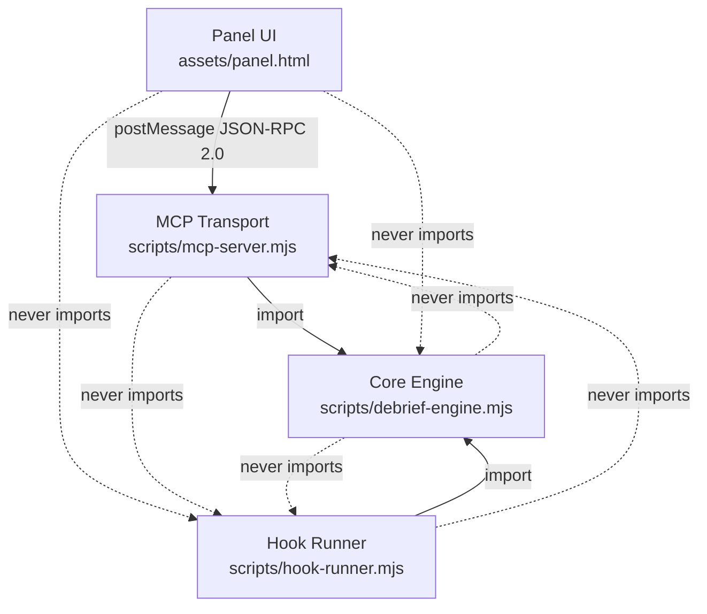
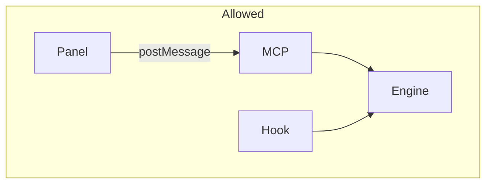
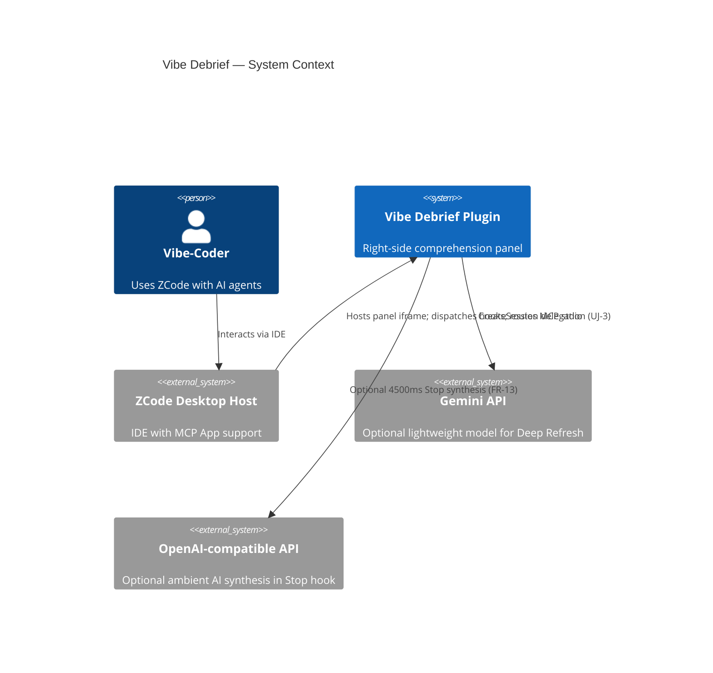
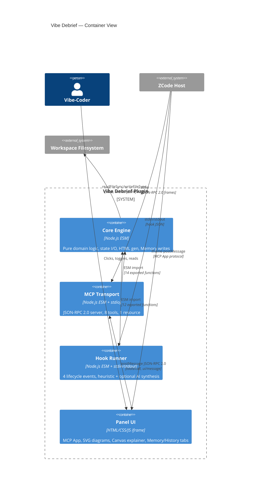
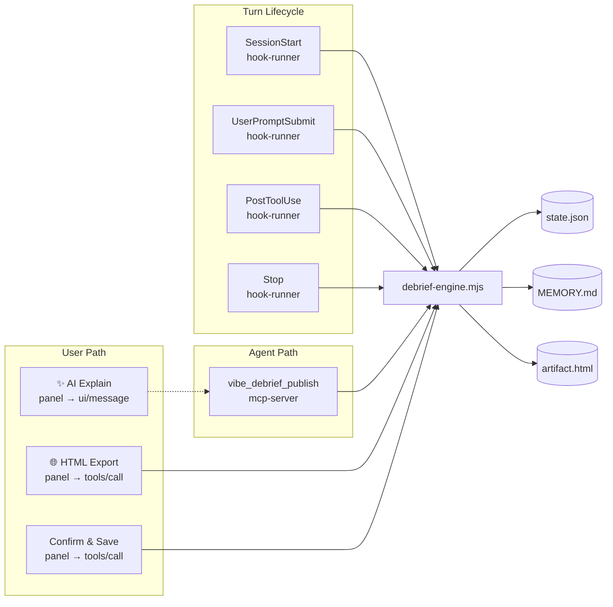

# Architecture Spine — vibe-debrief

## Design Paradigm

**Strict-Layered (4-Layer Unidirectional)** — four runtime layers with one-way dependency flow and exclusive runtime concerns:



Each layer maps to exactly one file. The Engine is the shared dependency; MCP and Hook are siblings that never import each other; the Panel communicates with MCP exclusively via `postMessage`.

## Invariants & Rules

### AD-1 — Strict 4-Layer Separation `[ADOPTED]`

- **Binds:** all
- **Prevents:** Cross-layer coupling that breaks independent testability and stdout isolation.
- **Rule:** Four runtime layers, each in exactly one file. Layer concerns are exclusive:
  - **Core Engine** (`debrief-engine.mjs`): Pure domain logic, file I/O, state schemas, HTML artifact generation, Memory writes.
  - **MCP Transport** (`mcp-server.mjs`): JSON-RPC 2.0 stdio protocol, tool dispatch, resource serving.
  - **Hook Runner** (`hook-runner.mjs`): ZCode lifecycle event handling (`SessionStart`, `UserPromptSubmit`, `PostToolUse`, `Stop`).
  - **Panel UI** (`panel.html`): Self-contained MCP App iframe rendering via `postMessage` bridge.

### AD-2 — Unidirectional Dependency Flow `[ADOPTED]`

- **Binds:** all
- **Prevents:** Circular dependencies; requiring MCP stdio setup or hook stdin to unit-test Engine logic.
- **Rule:** Dependencies flow strictly downward:
  - `mcp-server.mjs` → `debrief-engine.mjs` ✅
  - `hook-runner.mjs` → `debrief-engine.mjs` ✅
  - `panel.html` → MCP server (via `postMessage` only) ✅
  - Engine never imports MCP, Hook, or Panel. MCP never imports Hook. Hook never imports MCP. Panel never imports any `.mjs` file.



### AD-3 — Stdout Isolation `[ADOPTED]`

- **Binds:** `RULE-4`, `FR-9`–`FR-13`
- **Prevents:** Debug logging corrupting JSON-RPC frames or hook JSON output.
- **Rule:**
  - `mcp-server.mjs`: `stdout` reserved for JSON-RPC 2.0 response/error frames (`sendResponse`, `sendError`). Never `console.log` to `stdout`.
  - `hook-runner.mjs`: `stdout` reserved for a single JSON line per invocation (`{}` or `{ additionalContext }`). Never `console.log` to `stdout`. Diagnostics, if any, use `stderr` only.
  - `debrief-engine.mjs`: Never reads `stdin`, never writes `stdout`. Zero `process.stdin`, `process.stdout`, or `console.log` calls. Only `process.env` and `process.cwd()` are referenced.

### AD-4 — Zero External Dependencies `[ADOPTED]`

- **Binds:** `RULE-2`, all files
- **Prevents:** Supply-chain risk, install friction, bundler requirement.
- **Rule:**
  - Backend `.mjs` files import only `node:` built-ins (`node:fs`, `node:path`, `node:os`, `node:readline`, `node:url`). No `package.json`, no `node_modules`.
  - `panel.html` loads zero external `<script>`, `<link>`, fonts, or CDN resources. All CSS, SVG, and Canvas rendering is inline.
  - `hook-runner.mjs` uses Node 18+ built-in `fetch` for optional AI synthesis — no polyfill or npm package.

### AD-5 — Engine Owns Persistent State & Canonical Normalization `[ADOPTED]`

- **Binds:** `FR-2`, `FR-3`, `FR-5`, `FR-8`, `FR-25`–`FR-28`
- **Prevents:** Split persistence logic, direct disk writes outside Engine, and divergent `Debrief`/`history` shapes between MCP and Hook callers.
- **Rule:** `debrief-engine.mjs` exclusively owns all file I/O and canonical state builders:
  - `loadPersistedState` / `savePersistedState` → `{workspaceRoot}/.zcode/vibe-debrief-state.json` (seeds `createWelcomeDebrief` when missing; ignores write failures gracefully on read-only workspaces).
  - `confirmAndSaveLessonToZCodeMemory` → `{memoryDir}/{slug}.md` + `MEMORY.md` (falls back to `{workspaceRoot}/.zcode/memory/` if `~/.zcode/cli/memories` is unwritable).
  - `saveStandaloneHtmlArtifact` → `{outDir}/vibe-debrief-{timestamp}.html` (`ZCODE_VISUALIZATION_DIR` or `{workspaceRoot}/.zcode/vibe-debrief-artifacts/`).
  - `discoverLightweightGeminiModels` → `~/.zcode/v2/{provider_config,setting,credentials}.json` (fallback `new-provider/gemini-3.8-flash`).
  - Canonical `Debrief` enrichment (`buildDefaultDiagram`, `buildDefaultVerificationData`, `assessWorkflowComplexity`, `computeSte100Metrics`, `history` cap ≤ 15) executes via Engine builders; MCP and Hook never perform direct disk I/O to state/memory/artifact paths.
  - Panel has zero disk access (no inline diff editing or workspace file write-back).
  - *(v0.3.0 hardening note: cross-process atomic temp-file + `renameSync` for `savePersistedState` is tracked in `Deferred`.)*

### AD-6 — CSP & XSS Safety `[ADOPTED]`

- **Binds:** `RULE-3`, `FR-8a`, `FR-25`
- **Prevents:** XSS in MCP App iframe; CSP `unsafeEval` violations.
- **Rule:**
  - `panel.html` served with `_meta["zcode/csp"].unsafeEval: false`.
  - No `eval()`, `new Function()`, or inline `onclick=` attributes anywhere in `panel.html`.
  - All dynamic strings in HTML/SVG use `escapeHtml()` (escapes `&`, `<`, `>`, `"`).
  - `generateStandaloneHtmlArtifact` escapes `<` as `\u003c` inside embedded JSON payloads.

### AD-7 — Reading-Boundary & Evidence-Backed Proof `[ADOPTED]`

- **Binds:** `RULE-1`, `FR-14`, `FR-15`, `FR-21`
- **Prevents:** Agents dumbing down code or reasoning mid-task; unverified claims marked as `verified`.
- **Rule:**
  - STE-80 clarity (`applySte100Polish`, `computeSte100Metrics`: score `40–99`, `STE-80` `>= 80`, `Clear` `65–79`, `Dense` `< 65`) applies strictly at `vibe_debrief_publish`, `Stop` hook synthesis, and `confirmAndSaveLessonToZCodeMemory` — never to agent reasoning or mid-task prose.
  - `proofClaims` marked `verified` must cite observed tool or file results; unrun tests belong in `uncertaintyAudit`.

### AD-8 — 4-File Version Sync `[ADOPTED]`

- **Binds:** `RULE-5`
- **Prevents:** Version drift between plugin manifest, server info, panel appInfo, and hook banner.
- **Rule:** Every version bump updates all four locations atomically:
  1. `.zcode-plugin/plugin.json` → `version`
  2. `scripts/mcp-server.mjs` → `serverInfo.version`
  3. `assets/panel.html` → `appInfo.version`
  4. `scripts/hook-runner.mjs` → `additionalContext` banner string

### AD-9 — Panel–Host Communication Protocol `[ADOPTED]`

- **Binds:** `FR-8a`
- **Prevents:** Direct DOM access to host; network requests from panel; in-panel chat/diff sprawl breaking MCP App sandbox.
- **Rule:** `panel.html` communicates exclusively via `window.parent.postMessage` JSON-RPC 2.0 (`PROTOCOL_VERSION = "2026-01-26"`). No in-panel multi-turn chat thread or inline code-diff editor.
  - **Outbound:** `ui/initialize`, `ui/notifications/initialized`, `tools/call` (`vibe_debrief_get_state`, `vibe_debrief_set_persona`, `vibe_debrief_toggle_check`, `vibe_debrief_confirm_lesson`, `vibe_debrief_export_html`), `ui/message` (`[Vibe Debrief — Deep Refresh]` delegation).
  - **Inbound:** `ping` (health check reply), `ui/notifications/host-context-changed` (theme sync), `ui/notifications/tool-result` (state push).
  - Pending requests tracked via `rpcId` counter + `pendingRequests` Map with `15,000ms` timeout. Tool errors (`isError: true` or missing `structuredContent`) route to the toast/error banner, never `renderPanelState`.

### AD-10 — Single-State-Render Entry Point `[ADOPTED]`

- **Binds:** `FR-8a`
- **Prevents:** Partial UI updates, stale card/tab state, render path fragmentation, or background pushes clobbering transient UI state.
- **Rule:**
  - `panel.html` has one server-state render entry point: `renderPanelState(state)`, requiring a full `buildFullPanelState()` payload (`currentDebrief` present).
  - Server-owned `panelState` (`currentDebrief`, `history`, `confirmedLessons`, `zcodeMemory`) is strictly separated from panel-owned transient UI state (`activeTab`, `selectedNodeId`, `playerState`).
  - All tool results and `tool-result` notifications converge through `renderPanelState` → `renderActiveDebrief`, `renderExplainerTab`, `renderMemoryBank`, `renderHistoryList`.

### AD-11 — Never-Crash Hook Pattern `[ADOPTED]`

- **Binds:** `FR-9`–`FR-13`
- **Prevents:** Hook failure crashing the ZCode session lifecycle or blocking turn completion.
- **Rule:** `hook-runner.mjs` wraps every I/O path in `try/catch`:
  - `readStdinJson()`: returns `{}` on parse failure — never throws.
  - `synthesizeHeuristicDebrief()` runs unconditionally first (`<= 50ms` target latency) — always produces a valid debrief.
  - `tryOptionalAiDebriefSynthesis()` enforces `AbortSignal.timeout(4500)` (`4,500ms`) and returns `null` on any error (timeout, HTTP, JSON parse) — AI failure is invisible.
  - Transcript reading, file path resolution, and unknown modes degrade silently to `{}`.

### AD-12 — Complexity Gate for Explainer Scenes `[ADOPTED]`

- **Binds:** `FR-22`–`FR-24`
- **Prevents:** Visual clutter and Canvas overhead on simple 1–2 file turns.
- **Rule:** `explainerScenes` only populated when `assessWorkflowComplexity` scores `>= 4` (`complex`: files `>= 3` → `+2` / `>= 5` → `+3`, distinct layers `>= 2` → `+2` / `>= 3` → `+3`, branching/`>= 5` nodes → `+2`, critical-path file → `+1`, architectural keywords/length → `+1`). Override paths:
  - `complexityOverride: "complex"` in `vibe_debrief_publish` input.
  - `vibe_debrief_generate_explainer` tool (force-promotes complexity).
  - All other turns: `explainerScenes: []`, Explainer tab hidden.

### AD-13 — Turn-Handoff & Debrief Ownership `[ADOPTED]`

- **Binds:** `FR-3`, `FR-10`, `FR-12`, `RULE-6`
- **Prevents:** `Stop` hook overwriting an agent-published debrief or colliding with `CreateSession` Deep Refresh.
- **Rule:**
  - `UserPromptSubmit` clears `recentTouchedFiles`, `lastCommandExitZero`, and sets `agentPublishedThisTurn: false`. On `[Vibe Debrief — Deep Refresh]`, it injects mandatory delegation to the selected lightweight Gemini model via `CreateSession`.
  - `vibe_debrief_publish` sets `agentPublishedThisTurn: true`.
  - `Stop` checks `state.agentPublishedThisTurn && state.currentDebrief`: if `true`, it preserves `currentDebrief`, updates `lastAssistantMessage` and `turnCount`, clears the flag to `false`, and skips synthesis.

## Consistency Conventions

| Concern | Convention |
| --- | --- |
| **Naming (files)** | Backend scripts: `{purpose}.mjs` in `scripts/`. Single UI file: `panel.html` in `assets/`. Hooks config: `hooks/hooks.json`. Plugin manifest: `.zcode-plugin/plugin.json`. |
| **Naming (exports)** | Engine exports: `camelCase` verbs (`loadPersistedState`, `buildDefaultDiagram`). Constants: `UPPER_CASE` (`PERSONAS`). Tool names: `snake_case` with `vibe_debrief_` prefix. |
| **Naming (state keys)** | `camelCase` throughout (`currentDebrief`, `ste100Enabled`, `agentPublishedThisTurn`). |
| **ESM & imports** | All `.mjs` files; explicit `node:` prefix on built-ins (`node:fs`, `node:path`). Relative imports for `./debrief-engine.mjs`. |
| **Data formats (IDs)** | Debrief IDs: `debrief-{Date.now()}`. Lesson slugs: `slugify(title)` (lowercase, hyphens, max 48 chars). Check IDs: `chk-{index}`. |
| **Data formats (timestamps)** | ISO 8601 strings via `new Date().toISOString()`. |
| **Data formats (errors)** | MCP tool errors: `{ isError: true, content: [{ type: "text", text }] }` (JSON-RPC envelope succeeds). JSON-RPC protocol errors: `-32601` method not found, `-32602` invalid params, `-32603` internal error. |
| **State & schema evolution** | Engine: read-modify-write via `loadPersistedState` → merge patch → `savePersistedState`. Additive backward-compatibility via `createDefaultState` + `ensureDebriefEnriched`. Bounded collections: `history` ≤ 15, `recentTouchedFiles` ≤ 15, `confirmedLessons` ≤ 50. |
| **Error handling** | Engine: throws on critical failures (callers catch); ignores write errors on read-only workspaces. MCP: catches tool errors, wraps in `isError` result. Hook: never throws — catches everything, emits `{}` or `null` (`stderr` only for diagnostics). |
| **Config resolution** | Workspace root: `ZCODE_WORKSPACE_ROOT` → `ZCODE_PROJECT_DIR` → `CLAUDE_PROJECT_DIR` → `process.cwd()` (`hook-runner.mjs` checks `payload.cwd` first). Memory dir: `~/.zcode/cli/memories/projects/{slug}/memory/` → `{workspaceRoot}/.zcode/memory/`. |
| **Verification gate** | Every `.mjs` edit must pass: `node --check` on all 3 scripts, MCP stdio `initialize`/`tools/list`/`resources/list` handshake, and `hook-runner.mjs session-start` smoke test. Acceptance thresholds governed by PRD `SM-1`–`SM-5`. |

## Stack

| Name | Version |
| --- | --- |
| Node.js (ES Modules) | ≥ 18 (`fetch`), ≥ 20 (`node:test` stable); tested on v26.12.1 |
| MCP Protocol | `protocolVersion: "2025-11-25"` (JSON-RPC 2.0 over stdio) |
| MCP App Protocol | `PROTOCOL_VERSION: "2026-01-26"` (postMessage JSON-RPC 2.0) |
| HTML5 Canvas 2D | Built-in browser API (explainer animations) |
| Web Speech API | Built-in browser API (optional voice narration) |
| ZCode Plugin Manifest | `.zcode-plugin/plugin.json` v0.2.0 |

## Structural Seed

```text
vibe-debrief/
  .zcode-plugin/
    plugin.json              # Plugin metadata, version, UI surface registration
  .mcp.json                  # Stdio MCP server registration
  hooks/
    hooks.json               # 4 lifecycle event wiring
  scripts/
    debrief-engine.mjs       # Layer 1: Core Engine (21 exports, 9 internal helpers)
    mcp-server.mjs           # Layer 2: MCP Transport (8 tools, 1 resource)
    hook-runner.mjs          # Layer 3: Hook Runner (4 events)
  assets/
    panel.html               # Layer 4: Panel UI (MCP App, single-file)
  commands/
    eli5.md                  # /eli5 slash command
    vibe-debrief.md          # /vibe-debrief slash command
  skills/
    eli5/SKILL.md            # ELI5 skill instructions
    vibe-debrief/SKILL.md    # Vibe Debrief skill instructions
  tests/                     # [ASSUMPTION] v0.3.0 — node --test suite
    debrief-engine.test.mjs  # [ASSUMPTION] Engine unit tests
```

### System Context



### Container View



### Debrief Data Flow



## Capability → Architecture Map

| Capability / Area | Lives in | Governed by |
| --- | --- | --- |
| `FR-1` `vibe_debrief_open` | MCP (`handleToolCall`) → Engine (`buildFullPanelState`) | AD-1, AD-2, AD-5 |
| `FR-2` `vibe_debrief_get_state` | MCP (`handleToolCall`) → Engine (`loadPersistedState`, `buildFullPanelState`) | AD-1, AD-2, AD-5 |
| `FR-3` `vibe_debrief_publish` | MCP (`handleToolCall`) → Engine (diagram, complexity, verification, STE-80) | AD-1, AD-2, AD-3, AD-5, AD-7, AD-12, AD-13 |
| `FR-4` `vibe_debrief_set_persona` | MCP (`handleToolCall`) → Engine (`savePersistedState`) | AD-1, AD-5 |
| `FR-5` `vibe_debrief_toggle_check` | MCP (`handleToolCall`) → Engine (`savePersistedState`) | AD-1, AD-5 |
| `FR-6` `vibe_debrief_export_html` | MCP (`handleToolCall`) → Engine (`saveStandaloneHtmlArtifact`) | AD-1, AD-4, AD-6 |
| `FR-7` `vibe_debrief_generate_explainer` | MCP (`handleToolCall`) → Engine (`buildExplainerScenesForDebrief`) | AD-1, AD-12 |
| `FR-8` `vibe_debrief_confirm_lesson` | MCP (`handleToolCall`) → Engine (`confirmAndSaveLessonToZCodeMemory`) | AD-1, AD-5, AD-7 |
| `FR-8a` Panel bridge & theme sync | Panel (`postMessage`) ↔ MCP (stdio) | AD-9, AD-10, AD-6 |
| `FR-9` SessionStart hook | Hook → Engine (`loadPersistedState`, `discoverLightweightGeminiModels`) | AD-1, AD-3, AD-11 |
| `FR-10` UserPromptSubmit hook | Hook → Engine (`savePersistedState`) | AD-1, AD-3, AD-11, AD-13 |
| `FR-11` PostToolUse hook | Hook → Engine (`classifyFileRole`, `savePersistedState`) | AD-1, AD-3, AD-11 |
| `FR-12` Stop heuristic fallback | Hook → Engine (`synthesizeHeuristicDebrief`, `buildDefaultDiagram`) | AD-1, AD-3, AD-5, AD-11, AD-13 |
| `FR-13` Stop optional AI synthesis | Hook (`tryOptionalAiDebriefSynthesis`, built-in `fetch`) | AD-3, AD-11 |
| `FR-14`–`FR-15` STE-80 engine | Engine (`applySte100Polish`, `computeSte100Metrics`) | AD-7 |
| `FR-16` Personas | Engine (`PERSONAS`) + MCP + Panel | AD-1, AD-2 |
| `FR-17` Dual 4-card views | Panel (Bug vs Implementation sections) | AD-10 |
| `FR-18` Always-on diagram | Engine (`buildDefaultDiagram`) | AD-1, AD-12 |
| `FR-19` File role & risk | Engine (`classifyFileRole`) | AD-1 |
| `FR-20` Interactive node inspector | Panel (SVG click → `inspectNode`) | AD-10, AD-9 |
| `FR-21` Fused proof/uncertainty/checklist | Engine (`buildDefaultVerificationData`) + Panel | AD-1, AD-7, AD-10 |
| `FR-22` Complexity gate | Engine (`assessWorkflowComplexity`) | AD-12 |
| `FR-23`–`FR-24` Canvas player & script | Panel (Canvas 2D + `buildPlainTextScript` via Engine) | AD-4, AD-6, AD-12 |
| `FR-25`–`FR-26` Standalone HTML export | Engine (`generateStandaloneHtmlArtifact`, `saveStandaloneHtmlArtifact`) | AD-4, AD-6, AD-5 |
| `FR-27`–`FR-28` Memory & history | Engine (`confirmAndSaveLessonToZCodeMemory`, `resolveZCodeMemoryDirectory`) | AD-5 |
| `RULE-1` Reading boundary | Engine + MCP + Hook (apply only at publish/synthesis) | AD-7 |
| `RULE-2` Zero deps | All layers | AD-4 |
| `RULE-3` CSP & XSS | Panel + Engine (HTML gen) | AD-6 |
| `RULE-4` Stdout isolation | MCP + Hook + Engine | AD-3 |
| `RULE-5` Version sync | All 4 files | AD-8 |
| `RULE-6` Cost-aware delegation | Hook (`UserPromptSubmit` Deep Refresh) + Engine (`discoverLightweightGeminiModels`) | AD-1, AD-2, AD-13 |

## Deferred

| Area | Reason it can wait |
| --- | --- |
| **OQ-2 Zero-dependency test suite** | Engine's pure-function design (no stdin/stdout, all state via params/returns) makes it directly testable via `node --test` (`tests/*.test.mjs`, Node ≥ 20) with zero npm deps. Priority targets: `applySte100Polish`, `computeSte100Metrics`, `assessWorkflowComplexity`, `escapeHtml`, `buildDefaultDiagram`, `classifyFileRole`, `confirmAndSaveLessonToZCodeMemory`. AD-4 constrains this to `node:test` only. Deferred to v0.3.0 epics. |
| **OQ-3 Hook AI synthesis disposition** | `Stop` hook optional AI synthesis (`VIBE_DEBRIEF_OPENAI_KEY`, 4,500ms timeout) and `CreateSession` delegation (`UserPromptSubmit` Deep Refresh) serve distinct triggers: Stop fires automatically at turn end (ambient enhancement); CreateSession fires on explicit user action (`✨ AI Explain`). Recommendation: keep both — mark Stop AI as "optional ambient enhancement" and CreateSession as "primary explicit refresh". Revisit after v0.3.0 telemetry. |
| **OQ-1 Primary v0.3.0 validation signal** | Product Owner decision (checklist interaction rate vs. `MEMORY.md` confirmation rate vs. repeat-bug rate) gating `SM-4`/`SM-5`; no architectural divergence risk. |
| **OQ-4 Automated version-sync check** | AD-8 is enforced manually today. A `scripts/check-version-sync.mjs` script can validate all 4 locations match. Deferred to v0.3.0 release hardening. |
| **Atomic state writes (AD-5 hardening)** | `savePersistedState` currently uses direct `writeFileSync` across separate MCP/Hook OS processes. Adding atomic temp-file + `renameSync` (and/or lockfile) prevents torn writes under concurrent invocation. Deferred to v0.3.0 hardening. |
| **Light-theme parity for SVG/Canvas** | Affects two units (`assets/panel.html` and `generateStandaloneHtmlArtifact` in `scripts/debrief-engine.mjs`); requires a shared theme-token contract so both bind SVG/Canvas colors to CSS variables. Deferred to v0.3.0 UX (`DESIGN.md` `[ASSUMPTION]`). |
| **ARIA/keyboard/reduced-motion** | Panel lacks `role`, `tabindex`, `aria-selected`, `aria-live`, and `prefers-reduced-motion` support. Deferred to v0.3.0 accessibility epic (`EXPERIENCE.md` `[ASSUMPTION]`). |
| **Deployment/environments** | Single-user desktop plugin installed via ZCode marketplace. No CI/CD pipeline, staging environments, or multi-user infrastructure to govern. |
